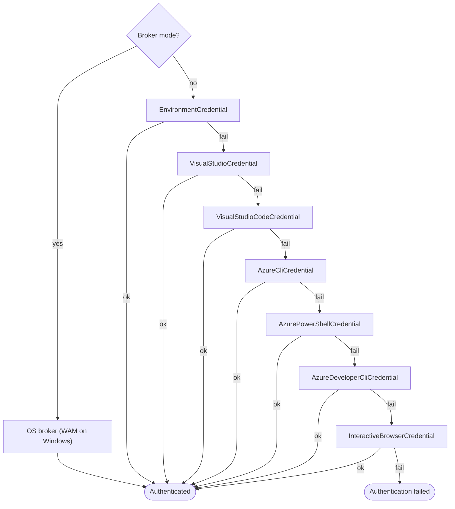
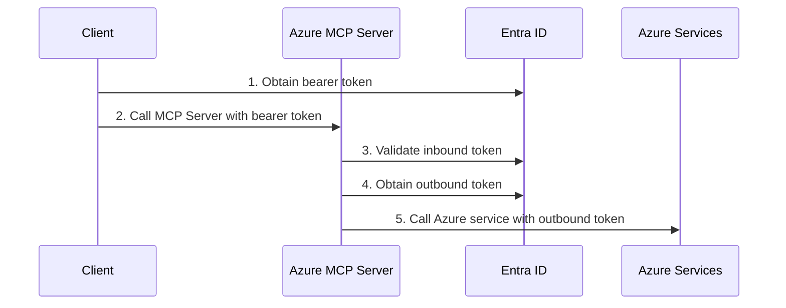

<!-- cspell:ignore CIMD PKCE -->

# Authentication in Azure MCP Server

Azure MCP Server runs in two transport modes — **stdio** (local) and **HTTP** (remote) — each with a different authentication model.

| | Stdio (local) | HTTP (remote) |
|---|---|---|
| **Who authenticates to Azure?** | The server itself, using your developer credentials | Depends on the outgoing auth strategy (see below) |
| **Inbound auth required?** | No — communication is over local process pipes | Yes — Entra ID bearer tokens protect every request |
| **Typical use** | IDE extensions, CLI, local agents | Cloud-hosted server shared by multiple clients/agents |

## Local Authentication (Stdio Transport)

When the server runs locally (the default), it authenticates directly to Azure services using credentials available on your machine.

### How credentials are resolved

The server uses a chain of credential providers. The first one that succeeds is used:



> [!NOTE]
> You can skip the chain and pin a specific credential by setting the `AZURE_TOKEN_CREDENTIALS` environment variable to the credential name. For example, to use only Azure CLI: `AZURE_TOKEN_CREDENTIALS=AzureCliCredential`.

> [!TIP]
> In VS Code, run **Azure: Sign In** from the Command Palette (ctrl+shift+p) to authenticate quickly.

### Broker mode

Set `AZURE_MCP_ONLY_USE_BROKER_CREDENTIAL=true` to skip the chain entirely and use the OS authentication broker (Web Account Manager on Windows). On unsupported operating systems it falls back to browser-based login.

### RBAC

Regardless of which credential is used, the authenticated identity must have the appropriate Azure RBAC roles on the target resources (for example, **Storage Blob Data Reader** for storage operations). See [What is Azure RBAC?](https://learn.microsoft.com/azure/role-based-access-control/overview) for details. For **User-Assigned Managed Identity**, also set `AZURE_CLIENT_ID` to the managed identity's client ID. If unset, System-Assigned Managed Identity is used.

### Choosing credentials by environment

| Environment | Recommended setup |
|---|---|
| **Local development** | Sign in with `az login`, VS Code Azure extension, or Azure PowerShell. The chain picks it up automatically. |
| **Azure Pipelines** | Use an Azure Resource Manager service connection with workload identity federation and select `AzurePipelinesCredential` as described below. |
| **Other CI / CD pipelines** | Set `AZURE_CLIENT_ID`, `AZURE_CLIENT_SECRET`, and `AZURE_TENANT_ID` environment variables (service principal). |
| **Production (hosted)** | HTTP transport is recommended for production hosting — see Remote [Authentication (HTTP Transport)](#remote-authentication-http-transport). If STDIO is required, set AZURE_TOKEN_CREDENTIALS=prod to restrict the chain to Environment, Azure Pipelines (when configured), Workload Identity, and Managed Identity credentials only — no interactive browser fallback. |

### Azure Pipelines workload identity

Azure MCP Server can authenticate as an Azure Resource Manager service connection configured with workload identity federation. This avoids client secrets and does not depend on Azure CLI or Azure PowerShell login state.

Set `AZURE_TOKEN_CREDENTIALS=AzurePipelinesCredential` in an `AzureCLI@2` or `AzurePowerShell@5` task and map `SYSTEM_ACCESSTOKEN` explicitly:

```yaml
- task: AzurePowerShell@5
  displayName: Run Azure MCP
  env:
    AZURE_TOKEN_CREDENTIALS: AzurePipelinesCredential
    SYSTEM_ACCESSTOKEN: $(System.AccessToken)
  inputs:
    azureSubscription: my-workload-identity-service-connection
    azurePowerShellVersion: LatestVersion
    scriptType: InlineScript
    Inline: |
      # Run Azure MCP commands here.
    pwsh: true
```

The task provides `AZURESUBSCRIPTION_TENANT_ID`, `AZURESUBSCRIPTION_CLIENT_ID`, and `AZURESUBSCRIPTION_SERVICE_CONNECTION_ID`. Azure Pipelines does not map `SYSTEM_ACCESSTOKEN` automatically, so the `env` entry shown above is required. These service connection variables are supported only by `AzureCLI@2` and `AzurePowerShell@5` tasks.

When `AZURE_TOKEN_CREDENTIALS=prod`, Azure MCP adds `AzurePipelinesCredential` after `EnvironmentCredential` only when all four variables are available, then preserves the `WorkloadIdentityCredential` and `ManagedIdentityCredential` fallbacks. The service connection identity must have the Azure RBAC permissions required by the commands being run.

---

## Remote Authentication (HTTP Transport)

When the Azure MCP Server is hosted remotely (for example, on Azure Container Apps) using HTTP transport, authentication operates in two layers:

1. **Inbound authentication** — the client authenticates to the Azure MCP Server (protocol-hardened in MCP 2026-07-28)
2. **Outbound authentication** — the Azure MCP Server authenticates to downstream Azure services and external MCP servers (see [External MCP Server OAuth Compliance](#external-mcp-server-oauth-compliance-mcp-2026-07-28) for registry server requirements under MCP 2026-07-28)



> [!NOTE]
> **MCP 2026-07-28 changes:** Inbound authentication validates JWT issuer, audience, and scope via Microsoft.Identity.Web. For registry-backed external MCP servers, HTTPS and non-empty scope entries are enforced by the server; issuer/audience validation of the outbound Azure Identity token is performed by the downstream resource. See [External MCP Server OAuth Compliance](#external-mcp-server-oauth-compliance-mcp-2026-07-28) for details.

> [!TIP]
> Want to get started quickly? The [`azd` templates](#deploy-with-azd-templates) below automate the entire setup illustrated above.

### Inbound Authentication

Every incoming request must carry a valid Entra ID bearer token with the required claims in the `Authorization` header. The inbound token can be obtained in one of two ways depending on the OAuth flow the client uses:

| OAuth Flow | Inbound Authentication | Required Claim |
|---|---|---|
| [Authorization Code](https://learn.microsoft.com/entra/identity-platform/v2-oauth2-auth-code-flow) | **Delegated** — a user signs in and obtains a bearer token | `Mcp.Tools.ReadWrite` scope |
| [Client Credentials](https://learn.microsoft.com/entra/identity-platform/v2-oauth2-client-creds-grant-flow) | **Application** — an application obtains a bearer token (no user involved) | `Mcp.Tools.ReadWrite.All` role |

> [!NOTE]
> The inbound authentication is determined entirely by the OAuth flow the client uses — the Azure MCP Server validates the incoming token and required claim but does not control how it is obtained.

### Client ID Metadata Documents (CIMD)

[CIMD support in Microsoft Entra ID](https://learn.microsoft.com/entra/agent-id/client-id-metadata-documents) is in public preview and is not recommended for production workloads. CIMD identifies the **client** using the URL of its metadata document; the MCP server remains a separately registered protected resource. The server does not host the client's document or require CIMD-specific token validation.

The `McpServer` settings below were added to support CIMD discovery and resource alignment. For the CIMD setup documented here, configure a non-root MCP endpoint at `/mcp`, its canonical resource URI, the delegated scope, and the tenant-specific CIMD authorization server. Do not rely on the unchanged root-endpoint defaults for this walkthrough.

> [!IMPORTANT]
> Use a non-root endpoint such as `https://mcp.contoso.com/mcp` for this setup, and match the resource URI and Application ID URI exactly, including trailing slashes. This avoids root-URL trailing-slash ambiguity; it is not a general CIMD prohibition on root MCP endpoints. The client's CIMD document URL is a separate URL and must itself have a nonempty path.

To use a CIMD-capable client with the remote server:

1. **Prepare the client and tenant.** Use a client that supports CIMD and the authorization code flow with PKCE, and a tenant where CIMD is available. The client must provide a stable, publicly accessible HTTPS metadata document URL with a path. Its document's `client_id` must exactly match that URL, and its redirect URIs must match those used by the client. A public client uses `token_endpoint_auth_method: none`. The client owner normally provides this document; see [Configure a client to use CIMD](https://learn.microsoft.com/entra/agent-id/configure-client-id-metadata-document). CIMD does not support the client credentials flow.
2. **Configure the server and its app registration.** Follow [Configure an MCP endpoint at `/mcp`](#configure-an-mcp-endpoint-at-mcp) below. That example sets all four `McpServer` options for this CIMD setup. Use the same canonical MCP endpoint URI for the Entra Application ID URI and `McpServer:ProtectedResource:Resource`, expose `Mcp.Tools.ReadWrite`, and advertise the corresponding `<Application ID URI>/Mcp.Tools.ReadWrite` scope. Configure `AzureAd` for the server's tenant and expected token audience.
3. **Verify CIMD discovery.** The configuration below advertises the tenant-specific preview identifier `https://login.microsoftonline.com/<tenant-id>/oauth21/2026-08`. Check `https://login.microsoftonline.com/<tenant-id>/oauth21/2026-08/.well-known/openid-configuration` and confirm `client_id_metadata_document_supported` is `true`. If it is absent or false, do not use a CIMD client ID; use another supported client registration method.
4. **Approve access.** The client requests the advertised resource and delegated scope. Tenant policy governs whether users can consent or an administrator must add the client and grant consent. During the preview, plan for administrator approval rather than relying on user consent; see [Manage CIMD clients in your tenant](#manage-cimd-clients-in-your-tenant). The signed-in user also needs appropriate Azure RBAC permissions for the requested operations.

Changing the advertised authorization server does not change `AzureAd` token validation. The configured server must accept the resulting token's issuer, audience, and `Mcp.Tools.ReadWrite` scope. Only single-tenant use has been validated; `common` and `organizations` have not.

#### Manage CIMD clients in your tenant

Entra ID represents each approved CIMD client as an agent identity in the tenant. Tenant administrators control which CIMD clients can access the MCP server. For full guidance, see [Manage CIMD clients in Microsoft Entra ID](https://learn.microsoft.com/entra/agent-id/manage-client-id-metadata-document-clients).

- **Choose who can add clients.** Use an *administrator-curated* posture, in which administrators review and add each client, or *policy-controlled user consent*, in which users can add clients that satisfy a custom permission grant policy. User consent for CIMD clients is controlled by **Allow user consent for unregistered apps and agents using Client ID Metadata Documents** under **Entra ID** > **Enterprise apps** > **Consent and permissions** > **User consent settings**.
- **Add a client in advance.** In the Microsoft Entra admin center, go to **Entra ID** > **Agents** > **Agent identities** > **Add CIMD client (Preview)** and enter the client's CIMD URL. Alternatively, create the agent identity with Microsoft Graph (beta). Creating an identity requires a role such as **Agent ID Administrator** or **AI Administrator**. Review the client owner, redirect URIs, and requested permissions before approval; CIMD proves control of a URL, not that the client is trustworthy.
- **Grant the MCP server's delegated scope.** Grant the client only the `Mcp.Tools.ReadWrite` delegated permission on the server's app registration. During the preview, grant permissions through the sign-in and consent endpoints or Microsoft Graph rather than the portal permissions experience. The admin consent request workflow is not available for CIMD clients, so users must give the CIMD URL, resource, and scope to an administrator.
- **Monitor and respond.** CIMD clients appear as agent identities in Entra sign-in and audit logs. To stop an untrusted client, disable its agent identity, revoke its delegated grants, and delete the identity when it is no longer needed. The CIMD URL is immutable: a client that moves its document to a new URL is a new identity that needs new consent.

### Protected Resource Metadata and Endpoint Configuration

MCP clients that are not pre-configured with authorization details discover them from the server's [OAuth 2.0 Protected Resource Metadata](https://www.rfc-editor.org/rfc/rfc9728) (PRM), which is linked from the `resource_metadata` parameter of the `WWW-Authenticate` header on `401` responses.

The settings in this section support the [CIMD setup above](#client-id-metadata-documents-cimd) by controlling the endpoint and the metadata clients use to obtain tokens. They are opt-in: existing deployments do not need to change. If you don't configure them, the server keeps its default behavior:

- The MCP endpoint is served at `/`.
- The PRM `resource` is derived from the request scheme and host.
- The authorization server is `<AzureAd:Instance>/<AzureAd:TenantId>/v2.0`.
- The advertised scope is `<AzureAd:ClientId>/Mcp.Tools.ReadWrite`.

For the CIMD walkthrough, explicitly configure the values in the example below rather than relying on these defaults. Clients send the PRM `resource` as an [RFC 8707](https://www.rfc-editor.org/rfc/rfc8707) `resource` parameter that must match an Application ID URI registered in Entra ID. These settings can also be used independently of CIMD when a deployment needs explicit endpoint or metadata values.

These settings use the standard .NET configuration system. Set them in `appsettings.json` or another configuration provider, or override them with environment variables.

| Configuration key | Environment variable | Description |
|---|---|---|
| `McpServer:EndpointPath` | `McpServer__EndpointPath` | Path at which the MCP endpoint is mapped, for example `/mcp`. Defaults to `/`. When set, `/` no longer serves MCP requests. |
| `McpServer:ProtectedResource:Resource` | `McpServer__ProtectedResource__Resource` | Canonical URI that clients use for the MCP endpoint, advertised as the PRM `resource`, for example `https://mcp.contoso.com/mcp`. Must be `https` (`http` is allowed only for loopback hosts) and must not contain a query or fragment. The value is advertised exactly as configured. |
| `McpServer:ProtectedResource:AuthorizationServers:0` | `McpServer__ProtectedResource__AuthorizationServers__0` | Authorization server identifier to advertise instead of the default. For the CIMD preview, use the tenant-specific identifier shown below. Add more entries with `:1`, `:2`, and so on. |
| `McpServer:ProtectedResource:ScopesSupported:0` | `McpServer__ProtectedResource__ScopesSupported__0` | Delegated scope to advertise instead of the default, for example `https://mcp.contoso.com/mcp/Mcp.Tools.ReadWrite`. Add more entries with `:1`, `:2`, and so on. |

#### Configure an MCP endpoint at `/mcp`

1. For this CIMD setup, choose a non-root URL that clients will use for the MCP endpoint, for example `https://mcp.contoso.com/mcp`.
2. In the MCP server's Entra ID app registration, add the same URL as an Application ID URI. Make sure the app exposes the `Mcp.Tools.ReadWrite` delegated scope. Depending on your tenant's app management policies, Entra ID may require an `https` Application ID URI to use a verified domain of the tenant.
3. Configure the server's `AzureAd` settings. If tokens are issued with the Application ID URI as their audience, set `AzureAd:Audience` to the value in the token's `aud` claim.
4. Add all four `McpServer` settings to `appsettings.json`, replacing `<tenant-id>` with the same tenant configured in `AzureAd`:

   ```json
   {
     "McpServer": {
       "EndpointPath": "/mcp",
       "ProtectedResource": {
         "Resource": "https://mcp.contoso.com/mcp",
         "AuthorizationServers": [
           "https://login.microsoftonline.com/<tenant-id>/oauth21/2026-08"
         ],
         "ScopesSupported": [
           "https://mcp.contoso.com/mcp/Mcp.Tools.ReadWrite"
         ]
       }
     }
   }
   ```

   Or set the equivalent environment variables:

   ```bash
   export McpServer__EndpointPath=/mcp
   export McpServer__ProtectedResource__Resource=https://mcp.contoso.com/mcp
   export McpServer__ProtectedResource__AuthorizationServers__0="https://login.microsoftonline.com/<tenant-id>/oauth21/2026-08"
   export McpServer__ProtectedResource__ScopesSupported__0=https://mcp.contoso.com/mcp/Mcp.Tools.ReadWrite
   ```

5. Start the server in remote HTTP mode and configure MCP clients to connect to `https://mcp.contoso.com/mcp`.
6. Verify the advertised metadata:

   ```bash
   curl https://mcp.contoso.com/.well-known/oauth-protected-resource/mcp
   ```

   The response should contain the configured `resource`, `authorization_servers`, and `scopes_supported` values. An unauthenticated request to `/mcp` returns `401` with a `resource_metadata` value that points to this metadata URL.

When the configured resource or endpoint includes a path, the server serves PRM at both the resource-specific URL defined by RFC 9728 (for example `/.well-known/oauth-protected-resource/mcp`) and `/.well-known/oauth-protected-resource`. Invalid values cause the server to fail at startup.

#### Override advertised authorization servers

For the CIMD preview, use the tenant-specific `AuthorizationServers` value in the complete example above. Outside this walkthrough, omitting `AuthorizationServers` preserves the default authorization server derived from `AzureAd`. Override it only when clients need a different authorization server identifier whose endpoints issue tokens for the configured tenant.

The equivalent environment variable is `McpServer__ProtectedResource__AuthorizationServers__0`. Advertise the authorization server identifier, not the full `/.well-known/openid-configuration` metadata URL.

Keep the following in mind when configuring these settings:

- **Align the resource, Application ID URI, and scope.** Clients may request a token with the PRM `resource` as the RFC 8707 `resource` parameter together with the advertised scope. Use exactly the same resource value in server configuration and Entra ID, including any trailing slash, and advertise scopes in the form `<Application ID URI>/Mcp.Tools.ReadWrite`.
- **Token validation is unchanged.** These settings only change what is advertised to clients and where the endpoint is mapped. Incoming tokens are still validated by Microsoft.Identity.Web using the `AzureAd` configuration section, including the issuer for `AzureAd__TenantId`, the audience, and the `Mcp.Tools.ReadWrite` scope or `Mcp.Tools.ReadWrite.All` app role. Advertised scopes must resolve to the `Mcp.Tools.ReadWrite` delegated permission on the server's app registration. If tokens are issued with an audience other than the client ID or `api://<client ID>`, configure the expected audience in the `AzureAd` section (for example, `AzureAd__Audience`).
- **Advertised authorization servers must issue tokens the server accepts.** Overriding `AuthorizationServers`, for example to point clients to a different or preview Entra ID discovery endpoint, does not change the issuer the server validates. Only advertise authorization servers whose tokens are issued by the tenant configured in `AzureAd__TenantId`.
- **Consent.** Users, or an administrator on their behalf, must consent to the client requesting the `Mcp.Tools.ReadWrite` delegated permission. If the client is not pre-registered in your tenant, review your tenant's user consent settings and grant admin consent where required.
- **Single-tenant only.** Issuer validation is bound to `AzureAd__TenantId`. Multi-tenant configurations (such as `organizations` or `common` authorities) have not been validated with these settings.

### Outbound Authentication

The `--outgoing-auth-strategy` flag (`UseOnBehalfOf` or `UseHostingEnvironmentIdentity`) is passed when starting the Azure MCP Server and controls how it obtains outbound tokens to access downstream Azure services:

| Outbound Authentication | Behavior |
|---|---|
| **On-Behalf-Of** (`UseOnBehalfOf`) | Azure MCP Server exchanges the inbound user bearer token for a new token to access the downstream service |
| **Hosting Environment Identity** (`UseHostingEnvironmentIdentity`) | Azure MCP Server uses the hosting environment identity (typically a Managed Identity) to obtain a token to access the downstream service |

> [!NOTE]
> If `--outgoing-auth-strategy` is not specified, the server defaults to **On-Behalf-Of** .

### Supported Authentication Combinations

Use the following to verify your chosen inbound and outbound combination is supported:

| Inbound Authentication | Outbound Authentication | Supported |
|---|---|---|
| Delegated | On-Behalf-Of | ✅ |
| Delegated | Hosting Environment Identity | ✅ |
| Application | Hosting Environment Identity | ✅ |
| Application | On-Behalf-Of | ❌ Application bearer token carries no user identity, so there is nothing to exchange in an On-Behalf-Of flow |

### Choosing an Outbound Authentication Strategy

The right strategy depends on your security, auditing, and deployment requirements:

| | On-Behalf-Of | Hosting Environment Identity |
|---|---|---|
| **Per-user RBAC** | Yes | No — shared identity |
| **Audit trail** | Per-user | Server identity only |
| **Inbound auth type** | Delegated only | Delegated or Application |
| **Setup complexity** | Higher | Lower |
| **Best for** | Multi-tenant / enterprise / compliance-sensitive scenarios | Single-team or single-client-application scenarios |

### Deploy with azd Templates

Configuring Entra ID app registrations, scopes, roles, and hosting infrastructure manually is complex. The following Azure Developer CLI (`azd`) templates automate the entire setup including deploying Azure MCP Server to Azure Container Apps:

| Template | Outbound Strategy | Client (Agent) |
|---|---|---|
| [**azmcp-obo-template**](https://github.com/Azure-Samples/azmcp-obo-template) | On-Behalf-Of | Foundry Agent, Copilot Studio, C# Client |
| [**azmcp-foundry-aca-mi**](https://github.com/Azure-Samples/azmcp-copilot-studio-aca-mi) | Hosting Environment Identity | Foundry Agent |

Each `azd` template provisions:

- Entra ID app registration(s) with the correct scopes and roles
- Managed identity with appropriate RBAC assignments
- Azure Container App configured to run the Azure MCP Server with all required environment variables and server flags

---

## External MCP Server OAuth Compliance (MCP 2026-07-28)

When the Azure MCP Server acts as an MCP client to external, OAuth-protected MCP servers (configured via registry), it must comply with MCP 2026-07-28 authorization hardening rules.

### OAuth Configuration Requirements

External MCP servers configured in the registry with `OAuthScopes` must meet these requirements:

| Requirement | Details |
|---|---|
| **HTTPS endpoint** | All OAuth-protected registry servers must use HTTPS (`https://` scheme) — enforced by the server |
| **Non-empty scopes** | All scopes in `OAuthScopes` must be non-empty strings — enforced by the server |
| **Issuer validation** | A deployment requirement: the server's issuer identity should be resolvable and validated by its OAuth provider. Azure Identity bearer tokens carry issuer/audience claims that the downstream resource validates; the Azure MCP registry client does not perform additional client-side issuer binding |
| **Application type** | A deployment requirement: registry servers should be registered as the correct OAuth application type (confidential vs public client) with their OAuth provider |
| **Scope registration** | A deployment requirement: all scopes in `OAuthScopes` should be registered with the OAuth provider |
| **Protected resource metadata** | Recommended: Publish `.well-known/oauth-protected-resource` metadata per [RFC 9728](https://www.rfc-editor.org/rfc/rfc9728) (OAuth 2.0 Protected Resource Metadata) |

### Known Limitation: MCP Protocol Resource Parameter

**Issue:** MCP 2026-07-28 protocol specifies that token endpoint requests include a `resource` parameter (per [RFC 8707](https://www.rfc-editor.org/rfc/rfc8707), Resource Indicators for OAuth 2.0), but some OAuth providers (e.g., Entra ID) do not support this parameter.

**Impact:** Access tokens are currently obtained **without** the resource parameter. This may result in overly-broad token scope.

**Workaround:** Configure your OAuth provider to accept token requests from Azure MCP Server even without the `resource` parameter. This is a known limitation documented in [modelcontextprotocol/csharp-sdk issue #939](https://github.com/modelcontextprotocol/csharp-sdk/issues/939).

**Recommended mitigation strategies:**
1. Use narrow OAuth scopes that limit token usage to specific resources
2. Implement rate limiting or request signing to protect token endpoints
3. Monitor token usage patterns for unexpected requests
4. Follow OAuth provider guidance for handling requests without the resource parameter

### Issuer Binding and Validation

When registering an external MCP server with OAuth scopes, ensure that:
- The server's URL matches its registered issuer identity
- The issuer is resolvable and publishes OpenID Connect metadata
- Your OAuth provider can validate the issuer claim in received tokens

Example registry entry for an OAuth-protected MCP server:

```json
{
  "servers": {
    "external-secure-server": {
      "url": "https://my-mcp-server.example.com",
      "title": "External MCP Server",
      "OAuthScopes": ["mcp:invoke"]
    }
  }
}
```

In this example:
- URL and issuer match (`my-mcp-server.example.com`)
- OAuth scopes are explicit and minimal
- The server is registered in your OAuth provider as a resource/API

### Testing OAuth-Protected External Servers

To verify compliance:

1. **Verify issuer resolution:** Ensure the server's `.well-known/openid-configuration` is reachable
2. **Test token acquisition:** Confirm tokens can be obtained with your configured scopes
3. **Test token usage:** Verify that MCP requests succeed with acquired tokens
4. **Test scope validation:** Confirm that requests with insufficient scopes are rejected
5. **Test issuer mismatch:** Verify rejection when token issuer doesn't match server identity

---