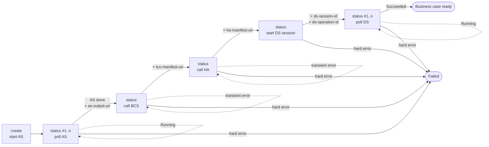
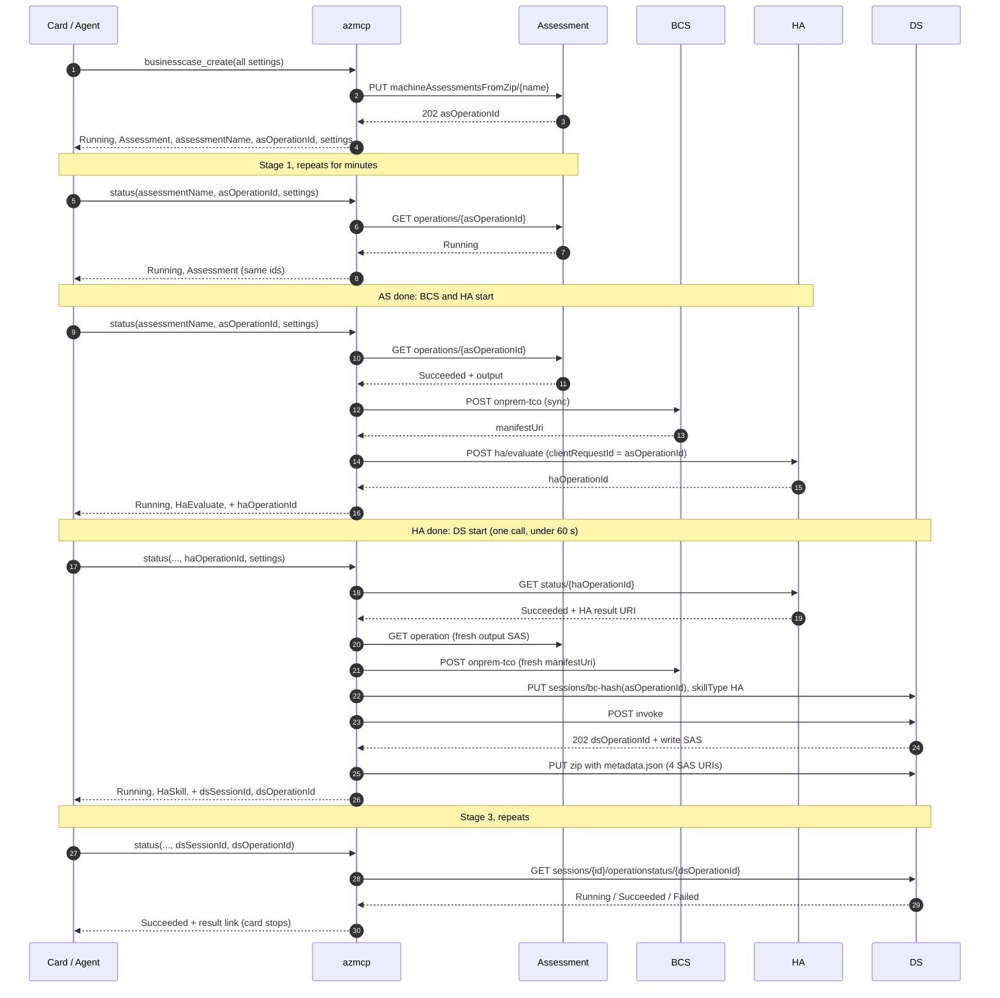
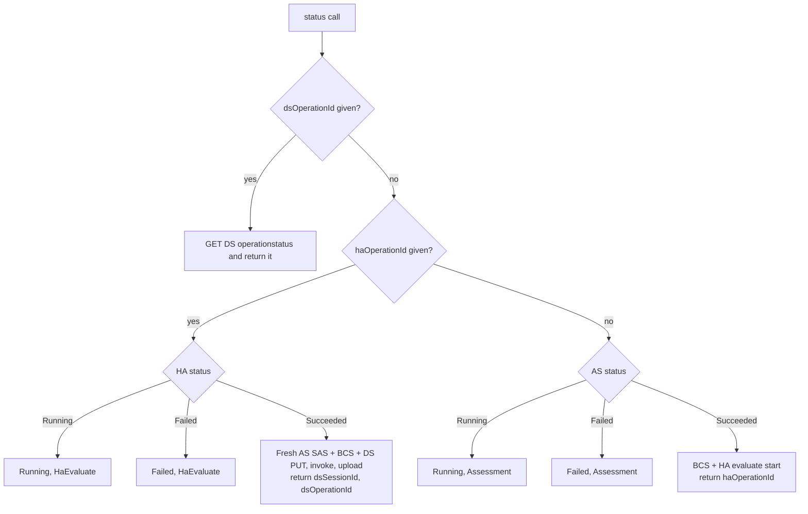
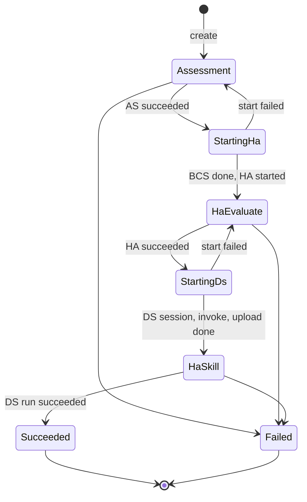
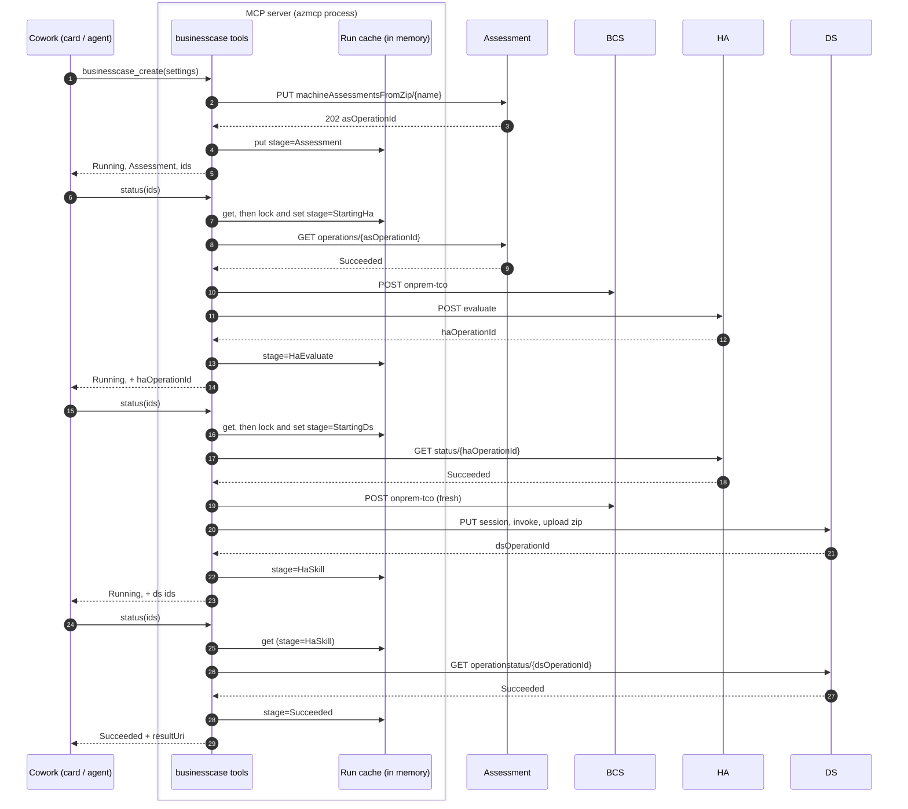

# Azure Migrate MCP tools: business case plan

This document records the design, decisions and open items for creating a business case from an
MCP client such as a Cowork plugin. It builds on
[inventory-assessment-ha-plan.md](inventory-assessment-ha-plan.md), which covers inventory,
assessment and the HA session.

## As implemented (v1)

The implementation follows open question 10 (HA is sync): it uses **2 stages, not 3**. Where this
section differs from the rest of the document, this section is the source of truth.

| Topic | Implemented behavior |
|-------|----------------------|
| Tools | `azuremigrate_businesscase_create` (starts the AS assessment only) and `azuremigrate_businesscase_status` |
| Stages | `Assessment` (stage 1) and `HaSkill` (stage 2); `totalStages: 2`. No `ha-operation-id` parameter. |
| Stage 1 → 2 | When AS succeeds, one status call runs BCS `POST /dataplane/onprem-tco`, HA `POST /dataplane/ha/evaluate`, then the DS session PUT, upload and invoke |
| Hosts | BCS `https://bcs-pvt-stamp04.ecy.prod.migration.windowsazure.com`, HA `https://ha-pvt-aksstamp10.ecy.prod.migration.windowsazure.com` (no `api-version`); overridable with `AZUREMIGRATE_BCS_SERVICE_URL` and `AZUREMIGRATE_HA_SERVICE_URL` |
| Ids | Every result has `nextStatusParameters` (kebab-case tool parameter names). Stage 2 adds `ds-session-id` and `ds-operation-id`; with both, status only reads the DS operation. |
| DS session id | Derived: `bc-` + first 16 hex chars of SHA-256 of the AS operation id, so a retry targets the same session. Never reuses another active session. |
| Inputs | `assessment-name`, `target-region`, `inventory-sas-uri`; `currency` is USD only (default USD); defaults: scaling factor 1.3, RI3Year, AHB Yes, Linux AHB Yes |
| HA settings | Defaults: network cost 5%, IaaS labor 75%, PaaS labor 60%, virtualization software 60%, licensing 5%, migration ramp `[0, 20, 50, 100]` (4 values, each 0–100) |
| DS manifest | `manifest.json` adds `businessCaseSasUri` (BCS manifest) and `haSasUri` (HA manifest) |
| Errors | Transient (no response, 408, 429, 5xx) → `Running`, retried on the next status call; other errors → `Failed` with `failedStep`. A DS 409 on the derived session → `Failed`. |
| HA mocked (`AZUREMIGRATE_HA_MOCK` not `false`) | The DS has no HA skill type yet, so instead of starting the DS session, the stage 1 → 2 call reads the HA evaluate manifest (SAS, no token) and finishes `Succeeded` (stage `HaSkill`). `result` is compact JSON: `currency` and, per strategy, `annualSavings`, `paybackPeriodYears`, `azureTotalCost`, `onPremisesTotalCost`, `yearOnYear`, or `unavailableReason`. A transient manifest read error stays `Running`; others fail with `failedStep: haResult`. |
| Not implemented | Run cache (decision 13) and the second-business-case warning (decision 11) |

Live validation (2026-11-19, server-type CMDB inventory, 12 machines, via the deployed MCP):
create, then status at 22 s (Running), then status at 44 s (`Succeeded`, 2.3 s call).
BCS and HA are both synchronous (about 1.5 s and 2 s), which answers Q2, so the stage 1 → 2 call
is short. A VMware CMDB inventory with `"GuestDetails": null` makes BCS return 500
(`CollectorInventoryReader.GuestFacts` indexes a JSON null); that needs a fix in the Business Case Service.

Still open: manifest keys expected by the HA skill (Q6), an HA skill type on the DS, and recovering
the DS operation id after a 409 on our own derived session (Q9).

## Design options for stage transitions (under evaluation)

### Option A: merged transition (implemented, v1)

When AS succeeds, a single status call runs AS GET, BCS, HA and the DS start. This keeps
`nextStatusParameters` free of SAS URLs, because BCS and HA results are consumed in the same call.
The worst-case transition call is about 150 s, which exceeds the 120 s Cowork limit.

### Option B: chained single-step stages (tool chaining)

Each `businesscase_status` call does **one** backend step and passes its result to the next call in
`nextStatusParameters`. The stage comes from the most advanced id or URI received, so azmcp still
stores nothing.



| # | Stage | Ids received | Action in this call | Adds to `nextStatusParameters` |
|---|-------|--------------|---------------------|--------------------------------|
| 1 | Assessment | `as-operation-id` | GET AS operation | `as-output-uri` when Succeeded |
| 2 | OnPremTco | + `as-output-uri` | POST BCS `/dataplane/onprem-tco` | `tco-manifest-uri` |
| 3 | HaEvaluate | + `tco-manifest-uri` | POST HA `/dataplane/ha/evaluate` | `ha-manifest-uri` |
| 4 | HaSkill | + `ha-manifest-uri` | PUT DS session `bc-<hash>`, upload, invoke | `ds-session-id`, `ds-operation-id` |
| 4 | HaSkill | + `ds-session-id`, `ds-operation-id` | GET DS operation | Result when Succeeded |

A transient failure (no response, 408, 429 or 5xx) returns `Running` with the same parameters, so
the next call retries that stage. Any other error returns `Failed` with `failedStep`.

### Comparison

| Criterion | Option A: merged | Option B: chained |
|-----------|------------------|-------------------|
| Worst-case single call | About 150 s (AS GET 60 s + BCS 45 s + HA 45 s), over the 120 s limit | About 45–60 s (one backend step) |
| SAS URLs in tool parameters and chat history | None (decision 7 holds) | AS output, BCS manifest and HA manifest SAS URLs (reverses decision 7) |
| SAS expiry if polling pauses | Not affected; fetched fresh | AS output SAS about 1 h, BCS manifest about 4 h; an expired URI fails the next stage, and recovery means re-running from stage 1 |
| Status calls on the happy path | Fewer (one transition call) | 2 more (separate BCS and HA calls) |
| Retry granularity | A transient BCS or HA failure retries the whole transition | Retries only the failed step |
| Risk of re-running BCS or HA | Low; DS ids short-circuit | Low; each later URI short-circuits the earlier step |
| Tampering or model errors | Ids only | The model could pass a wrong or stale URI; validate the host and that it is a blob SAS |
| Code change from v1 | None | 2 new stages, 3 new optional parameters, `totalStages: 4` |

### Mitigations if Option B is chosen

- Redact SAS URIs in logs and in `ToString` (already done for `HaInput` and `EvaluationResult`).
- Validate received URIs: HTTPS and a `*.blob.core.windows.net` host.
- On a 403 or expired-SAS error in stage 2 or 3, return `Failed` with instructions to start a new
  business case, or fall back to re-fetching the AS output from `as-operation-id`.
- Option: pass only `as-operation-id` and re-GET the AS output in stage 2 (adds a few seconds and
  keeps one SAS out of the parameters).

### Decision criteria

Choose **Option B** if measured BCS + HA duration (Q2, timing) keeps the merged transition near or
above about 100 s, or if partial retries matter. Keep **Option A** if measured worst-case transition
time stays well under 100 s, since it avoids SAS URLs in chat history.

## Goal

From one user request ("create a business case for my inventory"), run this chain:

1. **Assessment (AS):** create a machine assessment from the filtered inventory ZIP.
2. **On-premises TCO (BCS):** compute the on-premises cost from the assessment output and the
   inventory.
3. **HA evaluate (HA):** evaluate the business case from the assessment output and the BCS result.
4. **DS HA session:** create the Discovery Service (DS) session with the HA skill type, upload a
   zip holding `metadata.json` with the four result URLs, and track the DS operation to completion.

## Problem: Cowork tool call time limit

Cowork's MCP gateway cuts every tool call at **about 120 seconds** (measured: calls of 50, 70 and
100 s succeeded; calls of 120 s or more were cut at 119.9 s with `504 Gateway Timeout`). See the POC
and RCA in [PR 18010988](https://msazure.visualstudio.com/One/_git/AzureMigrate-DiscoveryService/pullrequest/18010988)
(`docs/design/CoworkMcpToolTimeout/README.md`). The MCP protocol has no limit and azmcp does not stop
the call, so this is a client limit we cannot change. Calls between 100 and 120 s were not tested,
so **100 s is the safe upper bound**.

The assessment takes minutes. Today `azuremigrate_assessment_create` polls the assessment for up to
about 17 minutes inside one tool call, so in Cowork:

- The user sees a tool error after about 120 seconds, even though the assessment keeps running and
  may succeed.
- The agent never receives the operation id, so it cannot track the job.
- Cowork drops the connection, which **cancels the request on the server** (confirmed by the POC),
  so the HA step never starts.
- Cowork does not retry, but a user retry can create a duplicate run or fail because the assessment
  name already exists.

Every API in the chain is fast on its own (a start call or a status GET). Only **waiting** between
them is slow, so the tool call must not wait.

### Client-side options considered

| Option | Outcome |
|---|---|
| Raise the Cowork timeout | Not configurable by plugins; the 120 s limit is fixed in the gateway. |
| MCP progress notifications | The spec lets clients reset the timeout on progress, but it is optional; Cowork support is untested. |
| MCP Tasks | Too new; Cowork support is unlikely. |
| Agent loops on status | Agent turns are limited and nothing wakes the agent later. |
| Another client (VS Code, CLI) | Works, but not for Cowork users. |

None fixes the problem reliably, so the design keeps every tool call short.

## Decision

Split the work into two short tools. Nothing needs to be stored: **each status result returns the ids
collected so far, and the next status call sends them back as plain parameters.** An optional
in-memory cache may help, but losing it is harmless (decision 13).

| Tool | Does | Time |
|---|---|---|
| `azuremigrate_businesscase_create` | Validates every setting, sends the AS PUT and returns the assessment name, AS operation id and the settings echoed back. Shows the status card. | About 1 s |
| `azuremigrate_businesscase_status` | Checks the operation of the most advanced id it receives; if that operation has finished, starts the next stage and returns its id. Never waits. | Under 60 s (target: a few seconds) |

### How Cowork knows the business case is finished

Cowork never talks to AS, BCS, HA or DS, and nothing pushes a result to it. It only learns the
state by calling `businesscase_status` and reading the top-level `status` field:

- The **card** calls status every 20-30 seconds, stops on `Succeeded` or `Failed`, and keeps the
  returned ids in its own data for the next call.
- The **model** calls status when the user asks, copying the ids from the latest status (or create)
  result in the chat.

`status` is `Succeeded` only when the last stage (the DS HA skill run) has succeeded, `Failed` as
soon as any stage fails, and `Running` otherwise. Which backend operation is polled depends on the
ids received (see [Stages](#stages)); no single backend operation represents the whole chain.

### Decisions and reasoning

| # | Decision | Reasoning | Trade-off |
|---|---|---|---|
| 1 | **Two tools: create (start) and status (track).** | The 120-second limit applies to each tool call, not to the job, and the assessment alone takes minutes. Every backend call is fast on its own; only waiting is slow. Returning immediately and checking later keeps every call short. This is the pattern the inventory upload already uses successfully in Cowork. | Someone has to call status for the job to progress. |
| 2 | **Status advances the chain: one check, and at most one stage start, per call.** | After AS finishes, something must start BCS, HA and DS. Doing it in the status call needs no new infrastructure and no DS change, and reuses the existing clients (`AssessmentCreateClient`, `DsHaSessionClient`, `HaInputPackage`). Each call stays well under 60 seconds, leaving headroom below the 100-second safe bound. | The chain pauses if nobody calls status (the chat is closed). Acceptable because status is only tracked in the creating chat (decision 5). |
| 3 | **Collect all settings once, at create.** | The user decides everything in one confirmation, which matters because a business case is costly to redo. Validation happens before anything starts, so a bad HA setting cannot fail the job minutes later. | Create has many parameters; defaults keep the common case short. |
| 4 | **Nothing stored; the ids travel with the calls as plain parameters.** | Each status result returns the ids collected so far (`asOperationId`, then `haOperationId`, then `dsSessionId` and `dsOperationId`) and the next call sends them back. azmcp stays stateless, so restarts and scale-out are safe, and no storage, locking or cleanup is needed in azmcp (an upstream microsoft/mcp fork). Plain parameters are transparent and debuggable. Considered and rejected: a DS workflow owning the chain (needs DS changes and service-to-service auth) and an azmcp-owned table (makes azmcp stateful). | The model must pass up to about six values correctly. The tool description requires the latest result's values unchanged; the card passes them mechanically. |
| 5 | **Track only in the creating chat; no lookup of earlier jobs.** | Users start a new chat to create a business case, not to ask about an old one. The ids live only in that chat, which removes the need for server-side job storage or a lookup API. | A job cannot be found from another chat. Revisit if users ask for it. |
| 6 | **Status acts on the most advanced id it receives.** | With `dsOperationId` it only reads DS; with `haOperationId` it reads HA; otherwise it reads AS. Earlier stages are never re-checked or restarted, so a normal poll cannot re-run BCS or HA or re-invoke DS. | An older set of ids (for example from the create result) makes status redo the check from that stage; starts are idempotent (decision 12), so this is safe. |
| 7 | **Never carry SAS URLs between calls; fetch them fresh.** | The AS output SAS lasts about an hour and the BCS manifest 4 hours, while a job can pause between polls. Fetching from the producing operation avoids expired links and keeps secrets out of parameters and chat history. BCS is therefore called again in the DS stage for a fresh manifest. | One extra GET per step and a second BCS call. If BCS is expensive, pass its manifest URI instead (open question). |
| 8 | **One status adapter per backend.** | AS, BCS, HA and DS each report status with different URLs, fields and values. Converting them to one `StageStatus` keeps the stage logic, the tool and the card unaware of backend differences, and limits a backend change to its adapter. | One small class per backend. |
| 9 | **Unknown status values and transient HTTP errors mean "still running".** | A new status value or a throttled call should not fail a long job; the next poll retries. Only explicit failures, 404 and auth errors end it. | A stuck operation looks like Running; the card shows elapsed time so the user can notice. |
| 10 | **Status card polls one call at a time; the agent calls status only when asked.** | The card updates without using agent turns, and nothing can wake the agent after its turn. Waiting for each call before the next avoids overlapping starts from the card. | Polling only while the chat is open (see decision 2). |
| 11 | **Warn on a second business case while one is running.** | DS allows one active HA session per user and skill type, so a second job would get a conflict at the DS stage. Warning is the smallest safe fix without a DS change. | The user must wait or accept the risk. |
| 12 | **Starts are idempotent, keyed on the AS operation id.** | A status call can repeat (card re-poll after a timeout, or the user asking while the card polls). The DS session id is derived from the AS operation id, so a repeated PUT returns the same session; the HA start uses the AS operation id as client request id; a DS invoke rejected because the session is already invoking is reported as Running. | Needs HA (and BCS, if it becomes async) to dedupe by client request id (open question); otherwise a repeat recomputes the same result. |
| 13 | **Optional in-memory run cache in azmcp, which may be lost.** | Covers the model dropping or mixing up ids, and stops two overlapping calls on the same instance from starting the same stage twice. Losing it is acceptable because the ids still travel with the calls (decision 4); see [Run cache](#run-cache-optional-may-be-lost). | Helps only on the instance that holds it; does not survive restarts or scale-out, so DS re-invoke protection is still needed (open question 9). |

### Alternatives considered

| Alternative | Why not (for now) |
|---|---|
| One tool call that waits for the whole chain (today) | Cut off by the Cowork time limit. |
| Status re-derives every stage from the AS operation id alone | DS has no session GET, so status cannot tell that the DS run already started; every poll would re-run BCS and HA and could re-invoke a finished DS session, overwriting its result. |
| Background task in azmcp | Lost on restart or scale-out; the forwarded user token may expire during the run. |
| azmcp-owned run record (Azure Table or Cosmos) | Makes azmcp stateful: needs storage, managed identity, concurrency control and cleanup, and is unlikely to be accepted upstream. |
| DS workflow or HA skill runs the whole chain | Durable and survives the user leaving the chat, but needs DS or skill changes and service-to-service access to AS, BCS and HA, and the skill run is capped at 55 minutes. Kept as the target if business cases must finish without the chat open. |
| Opaque continuation token holding the ids | Same as plain parameters but harder to debug. |

## Flow



How status picks what to check:



## Stages

| # | Stage | Ids received | Polled operation | When it succeeds, start | Returns |
|---|---|---|---|---|---|
| 1 | `Assessment` | `assessmentName`, `asOperationId` | AS GET operation | BCS `onprem-tco` (sync) and HA `evaluate` | `haOperationId` |
| 2 | `HaEvaluate` | + `haOperationId` | HA status | Fresh AS output SAS, BCS `onprem-tco` for a fresh manifest, DS session PUT, invoke, upload of the `metadata.json` zip | `dsSessionId`, `dsOperationId` |
| 3 | `HaSkill` | + `dsSessionId`, `dsOperationId` | DS GET `operationstatus` | Done | `resultUri` |

BCS is sync, so it is not a separate stage. If BCS becomes async, it becomes its own stage between
`Assessment` and `HaEvaluate` with a `bcsOperationId`. If HA `evaluate` is sync and reliably fast,
stages 1 and 2 merge and the DS start happens in the same call.

| Value | Set by | Needed until |
|---|---|---|
| `assessmentName`, `asOperationId` | create | The DS start (also the DS session id seed and HA client request id) |
| Settings (AS, BCS, HA) | User, at create | The DS start |
| `haOperationId` | The call that sees AS succeed | HA succeeds |
| `dsSessionId`, `dsOperationId` | The call that sees HA succeed | The end |

## Run cache (optional, may be lost)

azmcp may keep an in-memory record per business case. It is a best-effort helper: the ids still
travel with every call, and the tool works the same when the record is missing.

**Key:** `(userObjectId from the token, asOperationId)`. The user's object id is part of the key, so
one user can never read another user's record.

**Record:**

```json
{
  "stage": "HaEvaluate",
  "assessmentName": "bc-1234",
  "haOperationId": "...",
  "dsSessionId": null,
  "dsOperationId": null,
  "settings": { },
  "result": null,
  "updatedAt": "2026-11-19T10:00:00Z"
}
```

`settings` must not contain generated SAS URLs (decision 7); only the user-provided inventory SAS
may appear.

**How a status call finds the stage:**

1. Look up the record by `(user, asOperationId)`. Merge in the ids received in the call; for each
   id, the received value wins when both are present.
2. Take the stage from the record's `stage`. With no record (lost or a different instance), take it
   from the most advanced id received, as without the cache.
3. Poll the operation for that stage:

   | `stage` | Polls |
   |---|---|
   | `Assessment` | AS `operations/{asOperationId}` |
   | `HaEvaluate` | HA `status/{haOperationId}` |
   | `HaSkill` | DS `operationstatus/{dsOperationId}` |
   | `StartingHa`, `StartingDs` | Nothing; returns Running (another call is starting the next stage) |
   | `Succeeded`, `Failed` | Nothing; returns the stored result |

4. If the operation has succeeded, under a per-key lock: set `stage` to `StartingHa` or
   `StartingDs`, start the next stage, then save the new ids and the next stage. If the start
   fails, restore the previous stage so the next call retries.
5. Return every id collected so far, as without the cache.



Sequence with the cache (the cache is memory inside the azmcp process, not a separate service):



If the azmcp process restarts or the call lands on another instance, the cache lookup finds
nothing and the stage is taken from the ids Cowork sends back.

**Rules:**

- `stage` only chooses which operation to poll. The backend's answer decides Running, Failed or
  Succeeded.
- A transitional stage older than 2 minutes is treated as a failed start: it falls back to the
  previous stage so a crashed call does not block the run.
- Records expire 24 hours after `updatedAt`, and the cache has a size limit (LRU eviction).
- The cache never replaces idempotent starts (decision 12). If it is lost while the stage is
  `StartingDs`, a later call can still invoke DS again; that gap is closed only by DS (open
  question 9).

## Tool parameters

### `azuremigrate_businesscase_create`

| Group | Parameter | Required | Default |
|---|---|---|---|
| Assessment | `assessment-name` | Yes | - |
| Assessment | `region` (`azureLocation`) | Yes | - |
| Assessment | `currency` | Yes | - |
| Assessment | `inventory-sas-uri` (filtered ZIP) | Yes | - |
| Assessment | `scaling-factor` | No | 1.3 |
| Assessment | `savings-option` | No | RI3Year |
| Assessment | `azure-hybrid-benefit` | No | Yes |
| Assessment | `linux-azure-hybrid-benefit` | No | Yes |
| HA | `network-cost-percentage` | No | 5 |
| HA | `iaas-labor-cost-percentage` | No | 75 |
| HA | `paas-labor-cost-percentage` | No | 60 |
| HA | `management-labor-cost-percentage` | No | 60 |
| HA | `infrastructure-growth-rate` | No | 5 |
| HA | `migration-completion-by-year` (Year0-Year3) | No | 0, 20, 50, 100 |

`workspaceId` for the AS request is still open (see the TODO in the existing plan).

### `azuremigrate_businesscase_status`

| Parameter | Required | Source |
|---|---|---|
| `assessment-name`, `as-operation-id` | Yes | Create result |
| `inventory-sas-uri` and the HA settings | Yes | Create result (echoed) |
| `ha-operation-id` | After stage 1 | Latest status result |
| `ds-session-id`, `ds-operation-id` | After stage 2 | Latest status result |

The tool description tells the model to pass the values from the latest status result (or the
create result if there is none) unchanged.

### Status result

```json
{ "status": "Running", "stage": "HaEvaluate", "stageNumber": 2, "totalStages": 3,
  "assessmentName": "bc-contoso", "asOperationId": "...", "haOperationId": "...",
  "dsSessionId": null, "dsOperationId": null,
  "failedStep": null, "errorMessage": null, "resultUri": null,
  "retryAfterSeconds": 30, "instructions": "..." }
```

The user never sees operation ids, SAS URLs, parameter names or tool names.

## Backend requests

### AS create

```http
PUT https://asmsrv-pvt-stamp03.ecy.prod.migration.windowsazure.com/businessCaseRestApi/machineAssessmentsFromZip/{assessmentName}?api-version=2022-01-05-preview

{ "workspaceId": "<workspace id>",
  "inventorySasUri": "<filtered ZIP SAS>",
  "settings": { "azureLocation": "eastus", "currency": "USD", "scalingFactor": 1.3,
                "savingsSettings": { "savingsOptions": "RI3Year" },
                "azureHybridUseBenefit": "Yes", "linuxAzureHybridUseBenefit": "Yes" } }
```

Status: `GET .../machineAssessmentsFromZip/operations/{operationId}?api-version=2022-01-05-preview&workspaceId=...`.

| Service | Host | Route | `api-version` | Token |
|---|---|---|---|---|
| AS | `asmsrv-pvt-stamp03` (`AZUREMIGRATE_ASSESSMENT_SERVICE_URL` overrides) | `/businessCaseRestApi/machineAssessmentsFromZip/...` | `2022-01-05-preview` | ARM user token |
| BCS | `bcs-pvt-stamp04` | `POST /dataplane/onprem-tco` | none | ARM user token |
| HA | `ha-pvt-aksstamp10` | `POST /dataplane/ha/evaluate` | none | ARM user token |
| DS | `discoverysrv-pvt-stamp04` | `/mcprestapi/sessions/...` | `2026-11-11-preview` | DS MCP token |

All hosts are `*.ecy.prod.migration.windowsazure.com`.

### BCS on-premises TCO

```http
POST https://bcs-pvt-stamp04.ecy.prod.migration.windowsazure.com/dataplane/onprem-tco

{ "inputs": {
    "assessedMachines": { "uri": "<AS output SAS from a fresh GET>" },
    "inventory":        { "uri": "<filtered ZIP SAS>" } } }
```

Response (sync today):

```json
{ "id": "sync-<guid>", "status": "Succeeded",
  "result": { "manifestUri": "<SAS>", "expiresDateTime": "<call time + 4 h>", "fingerprint": "<sha256>" } }
```

### HA evaluate

```http
POST https://ha-pvt-aksstamp10.ecy.prod.migration.windowsazure.com/dataplane/ha/evaluate

{ "inputs": {
    "assessments": { "uri": "<AS output SAS from a fresh GET>" },
    "onPremTco":   { "uri": "<BCS result.manifestUri>" } },
  "settings": { "networkCostPercentage": 5, "iaasLaborCostPercentage": 75, "paasLaborCostPercentage": 60,
                "managementLaborCostPercentage": 60, "infrastructureGrowthRate": 5,
                "perYearMigrationCompletionPercentage": { "Year0": 0, "Year1": 20, "Year2": 50, "Year3": 100 } } }
```

Response (sync, HA PR 17997258): same shape as BCS, `result.manifestUri` is a 4-hour SAS. An
identical request reuses the earlier result with fresh links.

### DS HA session

Reuses `DsHaSessionClient` with one change: the session id is derived from the AS operation id
(`bc-` plus a hash) instead of a random id, so a repeated PUT for the same business case returns
the same session (200). A 409 for a different active session means another business case is
running; status reports it as a failure of the DS stage instead of reusing that session. Then
invoke, which returns the write SAS and `dsOperationId`, and an upload of the zip with retries. An
invoke rejected with 400 `SessionState` (already invoking) is reported as Running. The zip holds
`metadata.json`:

```json
{ "inventorySasUri": "...", "assessmentSasUri": "...",
  "businessCaseSasUri": "<BCS result.manifestUri>", "haSasUri": "<HA result URI>" }
```

This extends today's two-key `manifest.json` in `HaInputPackage`.

## Operation status per backend

Each backend reports status differently. One adapter per backend converts its response into one
shape, so the stage logic, the tool and the card never see the differences:

```csharp
record StageStatus(StageState State, string? ResultUri, string? ErrorCode, string? ErrorMessage, TimeSpan? RetryAfter);
```

| Backend | Status call | Status field | Result | Error |
|---|---|---|---|---|
| AS | GET operation | `status` | `output` | `errorCode`, `errorMessage` |
| BCS | Sync response today; GET operation if made async | `status` | `result.manifestUri` | Open |
| HA | Open | Open | Open | Open |
| DS | GET `sessions/{id}/operationstatus/{op}` | `status` | `properties.result` | `error.code`, `error.message` |

Rules for every adapter:

- `Succeeded` maps to Succeeded; `Failed`, `Canceled` and `Cancelled` map to Failed; any other value
  maps to Running and is logged.
- HTTP 404 maps to Failed (the operation is gone). HTTP 429, 5xx and timeouts map to Running, so the
  next call retries. HTTP 401 and 403 map to Failed with an authentication error.
- Succeeded without a valid result URL maps to Failed at that step.
- `Retry-After` is returned as `retryAfterSeconds`, and the card waits at least that long.

## Safety

- **Short calls:** each outgoing HTTP call has a 30-second timeout and each status call makes at
  most one check and one stage start, staying under 60 seconds (100 s is the safe bound below
  Cowork's 120 s limit). The card's own request timeout for status (20 s in `InventoryUploadWidget`
  today) must be raised to about 90 s.
- **Repeated and overlapping calls:** status only checks the stage of the most advanced id it
  receives, so normal polls never redo earlier stages. A repeat with older ids (a card re-poll after
  a timeout, or the model using the create values) is safe because starts are keyed on the AS
  operation id: the DS session id is derived from it, the HA start uses it as client request id,
  and a DS invoke already in progress is reported as Running. If HA or BCS cannot dedupe, a repeat
  recomputes the same result, which is wasteful but correct.
- **No re-invoke of a finished DS run:** DS allows invoke again after `InvocationSucceeded` or
  `InvocationFailed`. Status never invokes when it receives `dsOperationId`, and the DS start only
  runs from an HA-succeeded check, so a finished run is not overwritten by normal polls. Remaining
  gap: two calls that both see HA succeed, or a later call without `dsOperationId`, can invoke
  again after the first run finishes. The run cache's lock narrows this on one instance; full
  protection needs DS (open question 9).
- **Failures:** a failed start is retried on the next status call; a failed operation is final and
  reported with `failedStep` (`assessment`, `onPremTco`, `haEvaluate`, `dsSession`, `upload`,
  `haSkill`) and the ids collected so far. Calling status again with those ids retries from that
  step.
- **Secrets:** bearer tokens and SAS query strings are never logged or shown to the user. Only the
  user-provided inventory SAS travels between calls; generated SAS URLs are fetched fresh.
- **One active HA session per user:** DS allows one active session per user and skill type, so a
  second business case would get a 409 at the DS stage. For v1, create warns when the user already
  has a business case running and lets them decide.

## Chat experience

1. **Start:** the agent proposes the settings (with defaults) and asks the user to confirm or change
   them, then calls create and shows the card: "Step 1 of 3: assessing machines".
2. **Progress:** the card polls status every 20-30 seconds, one call at a time, passing the ids
   from its latest result, and updates its steps on its own.
3. **Status question in the same chat:** the agent calls status once with the ids from the latest
   status (or create) result in the chat and answers, for example "Step 2 of 3: the business case
   evaluation is running".
4. **Finished:** the card shows the business case is ready; the agent offers a summary or the
   download link.
5. **Failure:** the card shows the failed step; the agent quotes the error and offers to retry from
   that step without redoing earlier steps.
6. **Second business case while one is running:** the agent warns and asks whether to start anyway.
7. **No inventory yet:** the agent asks the user to upload one first.

## Implementation steps

1. BCS and HA clients (start and status) behind interfaces, with mocks.
2. Status adapters per backend into `StageStatus`.
3. `businesscase_status` command that checks the most advanced id received and returns the ids
   collected so far.
4. `businesscase_create` command that only sends the AS PUT.
5. `DsHaSessionClient` session id derived from the AS operation id; `HaInputPackage` extended to
   the four-key `metadata.json`.
6. Status card based on `InventoryUploadWidget` that stores the returned ids, polls one call at a
   time, and has a status timeout of about 90 s.
7. Unit tests per stage with mocked clients: success, failure, 409, 400 already invoking, expired
   SAS, stale ids and repeated calls.
8. End-to-end test on Stamp04, then republish the Cowork plugin with the two new tools.
9. Remove the waiting loop from `azuremigrate_assessment_create` or route it through the new flow.
10. Optional: the in-memory run cache with a per-key lock, transitional stages, expiry and a size
    limit, plus tests for a missing record, merging ids and a stale transitional stage.

## Related risk

`azuremigrate_inventory_status` waits up to about 60 seconds per call. That is within Cowork's
120-second limit, but any increase must stay below the 100-second safe bound.

## Cross-repo impact

| Repo | Change |
|---|---|
| Business Case (AzureMigrate-BusinessCaseService) | Sync `onprem-tco` is fine if it reliably finishes within about 30 s; otherwise async (start plus status); accept the forwarded user token; dedupe by client request id; error shape. |
| HA (AzureMigrate-AppCentricAssessments) | `evaluate` response contract; sync is fine if it reliably finishes within about 30 s, otherwise async with a status contract; accept the forwarded user token; dedupe by client request id. |
| Reporting (AzureMigrate-Reporting) | None, unless it reads the BCS or HA outputs. To confirm. |
| Discovery Service and HA skill | Read the four-key `metadata.json`. No API change for v1. |

## Open questions

1. ~~HA `evaluate` response shape, status contract and typical duration~~ **Resolved (2026-11-19,
   HA PR 17997258):** sync, same shape as BCS: `200 {"id":"sync-<guid>","status":"Succeeded",
   "result":{"manifestUri":"<4 h SAS>","expiresDateTime","fingerprint"}}`, plus `reusedFromJobId` on
   reuse. An identical request reuses the earlier result with fresh links. Errors: 400
   `InvalidInputUri`, `InputUnreadable`, `WorkloadLimitExceeded` (over 1,000 records),
   `UnsupportedInput`; 500 `InternalEvaluationError` (retry); 503 `JobsNotConfigured`. Typical
   duration still to measure. Consequence: there is no `haOperationId`; see open question 10.
2. Whether BCS `onprem-tco` becomes async, its error shape and typical duration.
3. ~~Whether BCS and HA accept the user token azmcp forwards today~~ **Resolved (2026-11-19):**
   both accept the ARM-scoped user token (`https://management.azure.com/.default`), the same one AS
   uses. An empty body returned 400 (`InvalidInventory` from BCS, `UnsupportedInput` from HA), not
   401. Errors use `{ "error": { "code", "message" } }`.
4. Whether BCS and HA can dedupe repeated starts by client request id. **Partly resolved:** HA (and
   BCS, per the HA PR) reuse the result of an identical request, so repeats are cheap without a
   client request id.
5. ~~The `workspaceId` source for the AS request~~ **Resolved:** `AssessmentApi.ResolveWorkspaceId`
   already uses the parameter, then `AZUREMIGRATE_ASSESSMENT_WORKSPACE_ID`, then `azure-migrate-mcp`.
6. The zip file name and key names the HA skill expects. Today `HaInputPackage` writes
   `manifest.json` with `inventorySasUri` and `assessmentSasUri`; this plan adds `businessCaseSasUri`
   and `haSasUri` (file name `metadata.json` or `manifest.json`).
7. Whether Cowork resets its timeout on MCP progress notifications (worth a quick test).
8. Whether HA `evaluate` needs anything from BCS other than the manifest URI, and whether calling
   BCS again in the DS stage (for a fresh manifest) is acceptable in cost; otherwise the manifest
   URI travels between calls like the ids.
9. DS invoke protection against running a finished session again. Options: invoke on a session
   whose run has finished returns that run's `operationId` instead of running again (preferred,
   small DS change), or the caller supplies an operation id derived from the AS operation id.
10. With HA sync, merge the HA stage away: when AS succeeds, one status call runs BCS, HA and the DS
    start (session PUT, invoke, upload), leaving two stages (`Assessment`, `HaSkill`). Needs the
    measured BCS + HA duration to stay well under 60 s; otherwise split it across two calls.
