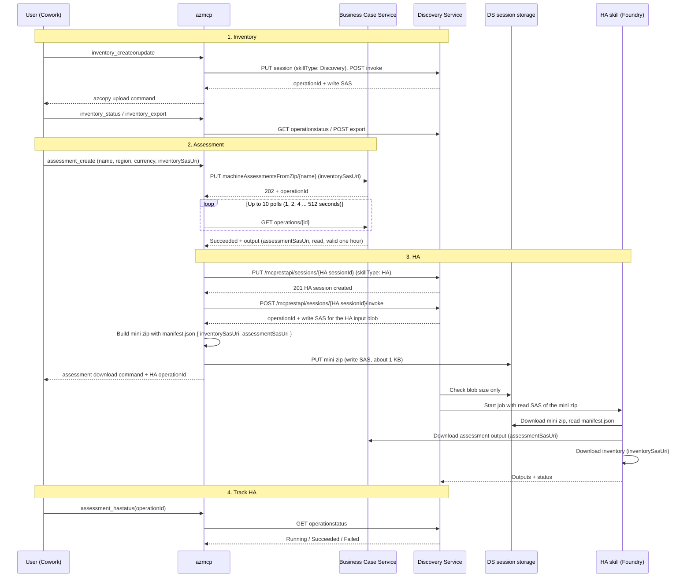

# Azure Migrate MCP tools: inventory, assessment and HA plan

This document records the plan, decisions and open items for the Azure Migrate tools in this
package. For hosting and configuration, see [inventory-deployment.md](inventory-deployment.md).

## Goal

Let a user drive the Azure Migrate flow from an MCP client (for example a Cowork plugin):

1. Refine their discovered inventory with the Discovery skill.
2. Download the refined inventory or the offline zip.
3. Create an assessment and wait for it to finish.
4. Start an HA session, upload its input and track it to completion.

The server forwards the caller's bearer token unchanged to the Discovery Service (DS) backdoor
`/mcprestapi` (api-version `2026-11-11-preview`). All sessions are isolated per user; DS reads and
writes only the caller's own partition.

## Tools

| Tool | Purpose | Backend |
|---|---|---|
| `azuremigrate_inventory_createorupdate` | Creates or reuses the user's Discovery session, invokes it and returns an upload command for the inventory file. With `text-only`, `session-id` and `message`, it refines an existing inventory from the message alone (corrections, guidance, questions) and returns no upload command. | DS session PUT + invoke (text-only: invoke with `inputType: Text`) |
| `azuremigrate_inventory_status` | Checks an inventory invocation once. | DS operationstatus |
| `azuremigrate_inventory_export` | Returns a download link and command for the refined inventory (`artifacts=external`) or the offline zip (`artifacts=internal`). | DS session export |
| `azuremigrate_assessment_create` | Creates the assessment from the user's collector ZIP (`inventory-sas-uri`), polls its operation up to 10 times with exponential backoff (1, 2, 4 ... 512 seconds, about 17 minutes), then starts the HA session, uploads the HA input mini zip and returns the assessment download command and the HA operation id. | Assessment create and operation status APIs + DS session PUT + invoke + HA input PUT |
| `azuremigrate_assessment_status` | Checks an assessment operation once; on success returns a new download link and command for the assessment output. | Assessment operation status API |
| `azuremigrate_assessment_hastatus` | Checks an HA operation once. | DS operationstatus |

## Flow

The HA steps use the mini-zip handoff (see [HA input](#ha-input-mini-zip)).


## Decisions

- **Separate create and status tools.** Each status tool checks once per call; the client decides
  when to ask again. The create assessment tool is the exception: it waits for completion so it can
  start the HA session in the same call.
- **Status tools take identifiers, not URLs.** The assessment status tool takes the operation id (the
  assessment name is optional and only echoed back) rather than a tracking URL, so the forwarded token
  is never sent to an arbitrary URL.
- **Export output choice.** `refined` (default) maps to `artifacts=external`, the customer-facing
  output. `offline` maps to `artifacts=internal`, the output used by publish.
- **HA is a DS skill session, not a separate API.** After the assessment succeeds, the tool creates a
  session with `skillType: HA` (overridable through `AZUREMIGRATE_HA_SKILL_TYPE`), reusing the
  user's active HA session on `409 ActiveSessionAlreadyExists`, then invokes it to get the operation
  id and input SAS URI.
- **azmcp uploads the HA input as a mini zip.** After the invoke, `HaInputPackage` builds a zip with only
  `manifest.json` (`inventorySasUri`, `assessmentSasUri`) and PUTs it to the returned write SAS (block blob,
  no Authorization header, up to 3 attempts for 408, 429, 5xx and network errors). See
  [HA input](#ha-input-mini-zip).
- **HA progress is tracked through DS operation status**, with the same response shape as Discovery
  sessions.
- **The assessment is the Business Case Service machine assessment from a collector ZIP**
  (api-version `2022-01-05-preview`): `PUT /businessCaseRestApi/machineAssessmentsFromZip/{assessmentName}`
  with `inventorySasUri` and `settings { azureLocation, currency }`, then
  `GET .../machineAssessmentsFromZip/operations/{operationId}`. Statuses are Running, Succeeded, Failed and
  Canceled; on Succeeded `output` is a read SAS (valid one hour, refreshed on each poll) of the
  recommendations JSON.
- **External assessment APIs are behind two interfaces.** `IAssessmentCreateClient` (create) and
  `IAssessmentOperationStatusClient` (operation status). Their implementations, `AssessmentCreateClient`
  and `AssessmentOperationStatusClient`, call the Assessment Service (`PUT
    /businessCaseRestApi/machineAssessmentsFromZip/{name}` and `GET .../operations/{id}?workspaceId=...`) through the
    shared `AssessmentApi` helper, forwarding the caller's token.
- **The user supplies the collector ZIP as a read SAS URL** (`inventory-sas-uri`). It is validated as an
  absolute http(s) URL and never logged or echoed.
- **Polling.** The create tool polls the operation up to 10 times, 1 second apart and doubling each
  time. Throttling, server and network errors are retried within that budget; 404 (operation not
  found) fails at once. If it is still running after the last poll, the tool returns the operation id
  and the HA session is not started.
- **Currency** must be one of the 25 codes the Business Case Service accepts.
- **Optional assessment settings come from the customer.** The required inputs are name, target region,
  currency and the inventory SAS URL. The optional settings are scaling factor, storage scaling factor,
  discount percentage, environment type, licensing program, billing subscription id, savings option,
  offer code, Defender for Cloud, disk types, pricing tier, storage redundancy, Windows and Linux Azure
  Hybrid Benefit, VM families, uptime, VM security options and management services. Only supplied
  settings are sent, so the service defaults apply to the rest. azmcp checks ranges and enum values
  (case-insensitive) before calling the service. If only one uptime value is given, the other uses its
  default (31 days, 24 hours).

## HA input: mini zip

The HA skill works on two read SAS URIs:

| Input | Source | Lifetime |
|---|---|---|
| `inventorySasUri` | The Cowork user, through the `inventory-sas-uri` parameter of `assessment_create`. | Set by whoever issued it. |
| `assessmentSasUri` | The `output` of the succeeded Business Case operation (recommendations JSON). | One hour from the last poll. |

The HA invoke returns a single write SAS for the HA input blob. Instead of downloading and repackaging
the files, azmcp uploads a mini zip that only points to them:

```
HA-input.zip
└── manifest.json   { "inventorySasUri": "https://...", "assessmentSasUri": "https://..." }
```

- **No Discovery Service change for the handoff.** DS treats the input blob as opaque: it checks only
  its size against the skill's maximum and passes a read SAS for it to the HA skill.
- **Crash-resilient.** azmcp makes one small PUT, which is atomic and safe to retry (it overwrites). The
  large downloads run inside the HA job, which has DS retries and operation status.
- **Fits Cowork limits.** No user-machine access and no long transfer inside a tool call.
- **HA skill change (SkillAgents).** When `manifest.json` is present, download both files at job start
  and copy them into session storage, because the assessment SAS expires after one hour. Never log the
  SAS query strings.
- **Late start.** If HA is started after the assessment link expired (for example from
  `assessment_status`), the tool first gets a fresh `assessmentSasUri` from the operation GET.
- Rejected: azmcp downloads, zips and uploads (lost on crash); the user's machine (not reachable from
  Cowork); DS takes the URIs in the invoke body (requires a DS change).
## Export behavior (DS)

- Export only returns a read-only SAS for blob names already recorded on the session. It does not
  generate anything.
- A run that produces output must write both the external and the internal blob, otherwise it fails
  with `SessionRequiredOutputsMissing`. Both names are recorded together.
- A turn that only answers a question keeps the previous outputs.
- Export returns 400 when the session has never produced output, when an older session has no
  internal blob (internal only), or while the session is invoking or publishing. The tool reports
  this as "not available yet".

## Dependencies

- DS exposes skill type `HA` and its operation status.
- DS deployment to the private stamp (Stamp04) with the session export API.

## Open items

- TODO: `workspaceId` is required by the Business Case Service contract (body and operation query) but
  is not sent yet. Decide how to choose it (for example the user's object id or DS session id).
- Implement `AssessmentCreateClient` and `AssessmentOperationStatusClient`, get the production URL and add the MCP server's app to the Business Case
  `BusinessCaseAppDetails` allowlist.
- Get the collector ZIP SAS from the Discovery Service instead of asking the user for it.
- About 17 minutes of polling may exceed some MCP client tool-call timeouts or the caller's token
  lifetime; revisit if needed.
- Confirm the HA operation status response shape once the HA skill exists.
- HA input: agree with the HA skill on the mini zip `manifest.json` shape. Confirm the HA inventory is
  the user's collector ZIP rather than the refined inventory (Discovery external artifacts).
- DS must register the `HA` skill type (`SkillType` has only Discovery and WavePlan today) and its
  skill configuration (`BlobRequired` input, maximum input size, hosted agent target).
- Cowork connector tool calls must finish within 30 seconds; `assessment_create` polls for up to about
  17 minutes, so it must return the operation id at once and let the client poll `assessment_status`.
- If the assessment is still running after the last poll, the HA session is not started. Decide
  whether to start it from the assessment status tool or a separate tool.
- A new chat has no session id, so export needs a DS "list my sessions" API to find it.
- Confirm that the offline zip is the internal artifacts output.
