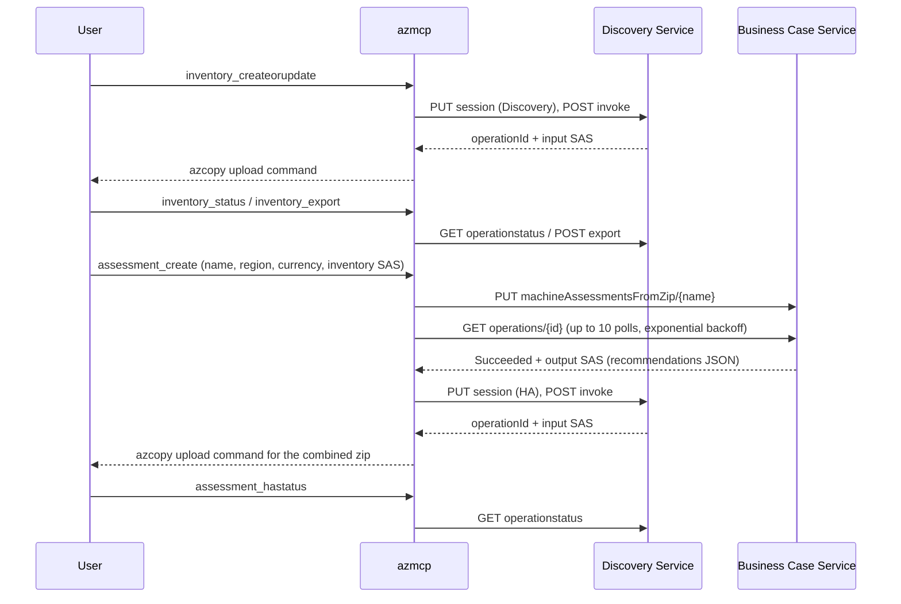

# Azure Migrate MCP tools: inventory, assessment and HA plan

This document records the plan, decisions and open items for the Azure Migrate tools in this
package. For hosting and configuration, see [inventory-deployment.md](inventory-deployment.md).

## Goal

Let a user drive the Azure Migrate flow from an MCP client (for example a Cowork plugin):

1. Refine their discovered inventory with the Discovery skill.
2. Download the refined inventory or the offline zip.
3. Create an assessment and wait for it to finish.
4. Start an HA session, upload its input and track it to completion.

The server forwards the caller's bearer token unchanged to the Discovery Service (DS) backdoor
`/mcprestapi` (api-version `2026-11-11-preview`). All sessions are isolated per user; DS reads and
writes only the caller's own partition.

## Tools

| Tool | Purpose | Backend |
|---|---|---|
| `azuremigrate_inventory_createorupdate` | Creates or reuses the user's Discovery session, invokes it and returns an upload command for the inventory file. | DS session PUT + invoke |
| `azuremigrate_inventory_status` | Checks an inventory invocation once. | DS operationstatus |
| `azuremigrate_inventory_export` | Returns a download link and command for the refined inventory (`artifacts=external`) or the offline zip (`artifacts=internal`). | DS session export |
| `azuremigrate_assessment_create` | Creates the assessment from the user's collector ZIP (`inventory-sas-uri`), polls its operation up to 10 times with exponential backoff (1, 2, 4 ... 512 seconds, about 17 minutes), then starts the HA session and returns the assessment download command and the HA upload command. | Business Case Service machine assessment from ZIP (mock when not configured) + DS session PUT + invoke |
| `azuremigrate_assessment_status` | Checks an assessment operation once; on success returns a new download link and command for the assessment output. | Business Case Service (mock when not configured) |
| `azuremigrate_assessment_hastatus` | Checks an HA operation once. | DS operationstatus |

## Flow

## Decisions

- **Separate create and status tools.** Each status tool checks once per call; the client decides
  when to ask again. The create assessment tool is the exception: it waits for completion so it can
  start the HA session in the same call.
- **Status tools take identifiers, not URLs.** The assessment status tool takes the operation id (the
  assessment name is optional and only echoed back) rather than a tracking URL, so the forwarded token
  is never sent to an arbitrary URL.
- **Export output choice.** `refined` (default) maps to `artifacts=external`, the customer-facing
  output. `offline` maps to `artifacts=internal`, the output used by publish.
- **HA is a DS skill session, not a separate API.** After the assessment succeeds, the tool creates a
  session with `skillType: HA` (overridable through `AZUREMIGRATE_HA_SKILL_TYPE`), reusing the
  user's active HA session on `409 ActiveSessionAlreadyExists`, then invokes it to get the operation
  id and input SAS URI.
- **The user supplies the HA input.** The user combines the refined inventory (Discovery external
  artifacts) and the assessment export into a single zip and uploads it with the returned azcopy
  command. The server does not download or repackage files.
- **HA progress is tracked through DS operation status**, with the same response shape as Discovery
  sessions.
- **The assessment is the Business Case Service machine assessment from a collector ZIP**
  (api-version `2022-01-05-preview`): `PUT /businessCaseRestApi/machineAssessmentsFromZip/{assessmentName}`
  with `inventorySasUri` and `settings { azureLocation, currency }`, then
  `GET .../machineAssessmentsFromZip/operations/{operationId}`. Statuses are Running, Succeeded, Failed and
  Canceled; on Succeeded `output` is a read SAS (valid one hour, refreshed on each poll) of the
  recommendations JSON. `BusinessCaseAssessmentServiceClient` is used when
  `AZUREMIGRATE_ASSESSMENT_SERVICE_URL` is set; otherwise `MockAssessmentServiceClient` (Running for 30
  seconds, then Succeeded with a fake output URL).
- **The user supplies the collector ZIP as a read SAS URL** (`inventory-sas-uri`). It is validated as an
  absolute http(s) URL and never logged or echoed.
- **Polling.** The create tool polls the operation up to 10 times, 1 second apart and doubling each
  time. Throttling, server and network errors are retried within that budget; 404 (operation not
  found) fails at once. If it is still running after the last poll, the tool returns the operation id
  and the HA session is not started.
- **Currency** must be one of the 25 codes the Business Case Service accepts.

## Export behavior (DS)

- Export only returns a read-only SAS for blob names already recorded on the session. It does not
  generate anything.
- A run that produces output must write both the external and the internal blob, otherwise it fails
  with `SessionRequiredOutputsMissing`. Both names are recorded together.
- A turn that only answers a question keeps the previous outputs.
- Export returns 400 when the session has never produced output, when an older session has no
  internal blob (internal only), or while the session is invoking or publishing. The tool reports
  this as "not available yet".

## Dependencies

- DS exposes skill type `HA` and its operation status.
- DS deployment to the private stamp (Stamp04) with the session export API.

## Open items

- TODO: `workspaceId` is required by the Business Case Service contract (body and operation query) but
  is not sent yet. Decide how to choose it (for example the user's object id or DS session id).
- Get the production Business Case Service URL and add the MCP server's app to the Business Case
  `BusinessCaseAppDetails` allowlist.
- Get the collector ZIP SAS from the Discovery Service instead of asking the user for it.
- About 17 minutes of polling may exceed some MCP client tool-call timeouts or the caller's token
  lifetime; revisit if needed.
- Add more assessment inputs from the customer beyond name, target region and currency.
- Align the HA upload window and maximum file size (currently 30 minutes and 500 MB, reused from
  inventory) with the DS HA skill configuration.
- Confirm the HA operation status response shape once the HA skill exists.
- If the assessment is still running after the last poll, the HA session is not started. Decide
  whether to start it from the assessment status tool or a separate tool.
- A new chat has no session id, so export needs a DS "list my sessions" API to find it.
- Confirm that the offline zip is the internal artifacts output.
