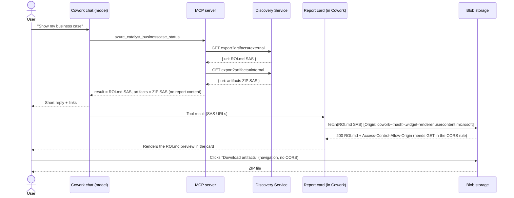

# Deploying the Azure Migrate inventory tools to Azure App Service (Microsoft tenant)

This guide hosts the Azure MCP Server on Azure App Service (Linux) in the Microsoft corporate tenant
(`72f988bf-86f1-41af-91ab-2d7cd011db47`) and exposes only the three Azure Migrate inventory tools:

| Tool | Purpose |
|---|---|
| `azuremigrate_inventory_createorupdate` | Creates (or reuses) the caller's inventory session on the Azure Migrate Discovery Service and returns a write-only upload URL and an `azcopy` command. With `--text-only` (requires `--session-id` and `--message`), it updates an existing inventory from the message alone (Discovery Service invoke `inputType: Text`, no session PUT) and returns no upload command. |
| `azuremigrate_inventory_status` | Tracks the inventory operation started by create-or-update. Each call waits up to about 60 seconds for it to complete; the agent repeats the call with the same session and operation until it completes, before export or assessment. |
| `azuremigrate_inventory_export` | Returns a read-only download URL and an `azcopy` command for an output of a finished inventory: the refined inventory (`output=refined`, the default; Discovery Service `artifacts=external`) or the offline zip (`output=offline`; `artifacts=internal`). |
| `azuremigrate_assessment_create` | Starts a machine assessment from the user's collector ZIP (`inventory-sas-uri`) for a target region and currency, polls its operation (up to 10 times with exponential backoff, 1 to 512 seconds, using the caller's token) and, when it succeeds, returns a download command for the assessment output, starts the HA skill on the Discovery Service (session PUT with skill type `HA`, then invoke) and uploads the HA input: a mini zip whose `manifest.json` holds the inventory and assessment read SAS URIs. If the assessment is still running after the last poll, returns the operation for the status tool and does not start the HA session. The assessment create and operation status calls go through `IAssessmentCreateClient` and `IAssessmentOperationStatusClient`, which call the Assessment Service with the caller's token. |
| `azuremigrate_assessment_status` | Returns the status of an assessment operation once per call and, when it has succeeded, a new download command for the assessment output. |
| `azuremigrate_assessment_hastatus` | Returns the Discovery Service operation status of the HA session started by `azuremigrate_assessment_create`, once per call. |

## How authentication works

```
MCP client ──(user token, aud = MCP app)──▶ Azure MCP Server (App Service) ──(same token, unchanged)──▶ Discovery Service /mcprestapi
```

- The MCP server validates the inbound Entra ID token (`AzureAd__*` settings).
- The inventory tools forward the **same** bearer token to the Discovery Service. No On-Behalf-Of exchange happens,
  so the MCP server's app registration must be the audience the Discovery Service accepts.
- Tokens and SAS query strings are never logged.
- The Discovery Service endpoint defaults to `DsBackdoorClient.BaseUrl` and can be overridden with
  `AZUREMIGRATE_DS_BASE_URL`.
- The assessment tools forward the same bearer token to the Assessment Service
  (`/businessCaseRestApi/machineAssessmentsFromZip`, api-version `2022-01-05-preview`). The endpoint defaults to
  Stamp03 and can be overridden with `AZUREMIGRATE_ASSESSMENT_SERVICE_URL`; the workspace id defaults to
  `azure-migrate-mcp` and can be overridden with `AZUREMIGRATE_ASSESSMENT_WORKSPACE_ID`. Create and status calls must
  use the same workspace id.

## Prerequisites

- Azure CLI signed in to the Microsoft tenant: `az login --tenant 72f988bf-86f1-41af-91ab-2d7cd011db47`.
- A subscription in the Microsoft tenant where you can create a resource group and an App Service.
- .NET SDK matching `global.json` (to publish the server).
- An Entra ID app registration in the Microsoft tenant (`<MCP_APP_ID>`) that:
  - exposes the delegated scope `Mcp.Tools.ReadWrite` (Application ID URI `api://<MCP_APP_ID>`);
  - is configured on the Discovery Service as the MCP audience (`Aad.Mcp.Audience = <MCP_APP_ID>`,
    `Aad.Mcp.RequiredScope = Mcp.Tools.ReadWrite`);
  - pre-authorizes every client that will call the MCP server for the scope, and those client app IDs are in the
    Discovery Service allow-list (`Aad.Mcp.AllowedCallerAppIds`), for example Visual Studio Code
    `aebc6443-996d-45c2-90f0-388ff96faa56` or Azure CLI `04b07795-8ddb-461a-bbee-02f9e1bf7b46`.

## 1. Set variables

```powershell
$tenant  = "72f988bf-86f1-41af-91ab-2d7cd011db47"
$sub     = "<SUBSCRIPTION_ID>"
$rg      = "<RESOURCE_GROUP>"
$loc     = "eastus2"
$plan    = "<APP_SERVICE_PLAN>"
$app     = "<WEB_APP_NAME>"          # becomes https://<WEB_APP_NAME>.azurewebsites.net
$mcpApp  = "<MCP_APP_ID>"

az account set --subscription $sub
```

## 2. Create the App Service

```powershell
az group create -n $rg -l $loc
az appservice plan create -g $rg -n $plan --is-linux --sku P0v3
az webapp create -g $rg -p $plan -n $app --runtime "DOTNETCORE:9.0"
az webapp config set -g $rg -n $app --always-on true
az webapp update -g $rg -n $app --https-only true
```

The published server is self-contained, so the runtime stack only provides the Linux host.

## 3. Configure app settings

```powershell
az webapp config appsettings set -g $rg -n $app --settings `
  ASPNETCORE_URLS="http://0.0.0.0:8080" `
  WEBSITES_PORT="8080" `
  ASPNETCORE_FORWARDEDHEADERS_ENABLED="true" `
  AZURE_MCP_DANGEROUSLY_ENABLE_FORWARDED_HEADERS="true" `
  AZURE_MCP_COLLECT_TELEMETRY="false" `
  AzureAd__Instance="https://login.microsoftonline.com/" `
  AzureAd__TenantId="$tenant" `
  AzureAd__ClientId="$mcpApp" `
  AzureAd__Audiences__0="$mcpApp" `
  AzureAd__Audiences__1="api://$mcpApp"
```

- The forwarded-headers settings are required because App Service terminates TLS in front of the app; without them
  the server advertises `http://` URLs in its OAuth protected resource metadata.
- Optional: `AZUREMIGRATE_INVENTORY_SKILL_TYPE` overrides the Discovery Service skill type (default `Discovery`).
- Optional: `AZUREMIGRATE_HA_SKILL_TYPE` overrides the Discovery Service skill type used for the HA session (default `HA`).
- Optional: `AZUREMIGRATE_HA_MOCK` (default on) mocks the HA step until the HA skill is deployed: the create tool returns a
  `ha-mock-*` session without calling the Discovery Service, and the HA status tool answers it with a mocked result. Set it
  to `false` to call the Discovery Service.
- Optional: `AZUREMIGRATE_DS_BASE_URL` points the inventory tools at a different Discovery Service, for example
  another stamp or a local OneBox.
- Optional: `AZMIGRATE_INVENTORY_WIDGET_DOMAINS` turns on the inventory upload panel. See
  [Enable the inventory upload panel](#7-optional-enable-the-inventory-upload-panel).

## 4. Set the startup command

```powershell
az webapp config set -g $rg -n $app --startup-file `
  "chmod +x /home/site/wwwroot/azmcp && /home/site/wwwroot/azmcp server start --transport http --tool azuremigrate_inventory_createorupdate --tool azuremigrate_inventory_status --tool azuremigrate_inventory_export --tool azuremigrate_assessment_create --tool azuremigrate_assessment_status --tool azuremigrate_assessment_hastatus --outgoing-auth-strategy UseHostingEnvironmentIdentity"
```

- `--tool` limits the server to the three inventory tools.
- `--outgoing-auth-strategy UseHostingEnvironmentIdentity` avoids the default On-Behalf-Of setup; the inventory tools
  forward the caller's token themselves and do not use the hosting identity.

## 5. Publish and deploy

From the repository root:

```powershell
$out = "$env:TEMP\azmcp-linux"
dotnet publish servers\Azure.Mcp.Server\src\Azure.Mcp.Server.csproj -c Release -r linux-x64 --self-contained -o $out
Compress-Archive -Path "$out\*" -DestinationPath "$env:TEMP\azmcp-linux.zip" -Force
az webapp deploy -g $rg -n $app --src-path "$env:TEMP\azmcp-linux.zip" --type zip
```

## 6. Verify

```powershell
$url = "https://$app.azurewebsites.net"

# Without a token the server must reject the call.
curl.exe -s -o NUL -w "%{http_code}`n" -X POST "$url/" -H "Content-Type: application/json" -d "{}"   # expect 401

# With a user token for the MCP app, list the tools.
$token = az account get-access-token --scope "api://$mcpApp/Mcp.Tools.ReadWrite" --query accessToken -o tsv
curl.exe -s -X POST "$url/" -H "Authorization: Bearer $token" -H "Content-Type: application/json" `
  -H "Accept: application/json, text/event-stream" `
  -d '{\"jsonrpc\":\"2.0\",\"id\":1,\"method\":\"tools/list\"}'
```

The second call requires Azure CLI to be pre-authorized on `<MCP_APP_ID>`. The response should list only
`azuremigrate_inventory_createorupdate`, `azuremigrate_inventory_status`, `azuremigrate_inventory_export`, `azuremigrate_assessment_create`, `azuremigrate_assessment_status` and `azuremigrate_assessment_hastatus`.

## 7. Optional: enable the inventory upload panel

With the panel on, MCP Apps hosts such as Cowork show an upload panel for `azuremigrate_inventory_createorupdate`
instead of an `azcopy` command. The panel uploads the user's file with a single browser PUT to the write-only SAS URL,
so the file never passes through MCP or the chat. It then polls `azuremigrate_inventory_status` with `no-wait` and
shows the operation's summary when the inventory finishes. Without the setting, the server keeps the `azcopy` flow.

All three parts are needed:

1. **App setting.** Set the origins of the storage accounts the Discovery Service issues upload SAS URLs for
   (comma-separated). The app restarts.

   ```powershell
   az webapp config appsettings set -g $rg -n $app --settings `
     AZMIGRATE_INVENTORY_WIDGET_DOMAINS="https://<REPORT_STORAGE_ACCOUNT>.blob.core.windows.net"
   ```

2. **Storage CORS rule** on each of those storage accounts (Blob service), so the browser PUT from the panel is
   allowed. The widget origin differs per host and per plugin, so use the host's wildcard origin:

   - Allowed origins: `https://*.widget-renderer.usercontent.microsoft`
   - Allowed methods: `PUT`, `OPTIONS`
   - Allowed headers: at least `x-ms-blob-type` and `content-type`, which the panel sends (or `*`)

3. **Plugin `validDomains`.** Cowork removes every widget connect domain that is not in the plugin package's
   `validDomains`, so the package must list the MCP server host and each storage host (no scheme), for example
   `"validDomains": ["<WEB_APP_NAME>.azurewebsites.net", "<REPORT_STORAGE_ACCOUNT>.blob.core.windows.net"]`.
   Bump the plugin version and re-publish it.

Verify with the same token as in step 6: in `tools/list`, `azuremigrate_inventory_createorupdate` must have
`_meta.ui.resourceUri` set to `ui://azuremigrate/inventory-upload-v2.html`, and `resources/read` for that URI must return
the panel HTML with the storage origins in its CSP connect domains.

Start a new chat after publishing, because an existing chat may keep the old tool list.

## 8. Optional: let a card read a blob in the browser (CORS `GET`)

A card (MCP Apps widget) that reads a SAS URL itself, for example to preview the business case `ROI.md` without the
MCP server downloading it, needs `GET` in the storage CORS rule. Allowing `PUT` for the upload panel does not allow it.

Why a link works but the card's `fetch` does not:

| Who sends the `GET` to the SAS URL | CORS check |
|---|---|
| User clicks a download link (browser opens or saves the file) | None. Navigation is not subject to CORS. |
| MCP server (`HttpClient`) | None. CORS exists only in browsers. |
| Card JavaScript (`fetch(sasUrl)`) | Yes. The response must carry `Access-Control-Allow-Origin` for the card's origin. |

The SAS token authorizes the request at storage; CORS only decides whether the browser hands the response to the
card's script. A plain `GET` has no preflight, but storage adds `Access-Control-Allow-Origin` only when a CORS rule
matches both the origin and the method, so without `GET` in the rule the card gets a CORS error even though the blob
was served. Each method must be listed; the rule is matched per method.

Flow for a business case report card that previews `ROI.md` in the browser:



If the fetch fails (no `GET` in the rule, or an expired SAS), the card shows the download link instead of the preview.

Rule on each storage account the card reads from (Blob service):

- Allowed origins: `https://*.widget-renderer.usercontent.microsoft` (keep it scoped; do not use `*`)
- Allowed methods: `PUT`, `GET`, `HEAD`, `OPTIONS` (`HEAD` is optional, to read the size before downloading)
- Allowed headers: `x-ms-blob-type`, `content-type` (or `*`)

The card must also list the storage origin in its CSP connect domains, and the plugin package must list the storage
host in `validDomains` (see step 7).

Verify the rule with the card's real origin (each plugin gets its own `cowork-<hash>` subdomain):

```powershell
$origin = "https://cowork-<hash>.widget-renderer.usercontent.microsoft"
$r = Invoke-WebRequest -Uri "<SAS_URL>" -Headers @{ Origin = $origin } -SkipHttpErrorCheck
$r.StatusCode; $r.Headers['Access-Control-Allow-Origin']   # 200 and the origin echoed back
```

## Troubleshooting

| Symptom | Check |
|---|---|
| `401` from the MCP server with a token | Token audience must be `<MCP_APP_ID>` or `api://<MCP_APP_ID>` and the tenant must match `AzureAd__TenantId`. |
| Card shows a CORS error reading a SAS URL, but the same link downloads fine | The storage CORS rule lacks `GET` for the widget origin (step 8). |
| Tool returns `401`/`403` from the Discovery Service | The client app ID is missing from `Aad.Mcp.AllowedCallerAppIds`, or the token lacks `Mcp.Tools.ReadWrite`. |
| Create reports an existing session | The user already has an active session for the skill type; the tool reuses it. |
| App fails to start | Run `az webapp log tail -g $rg -n $app`; confirm the startup command and that `azmcp` is in `/home/site/wwwroot`. |
