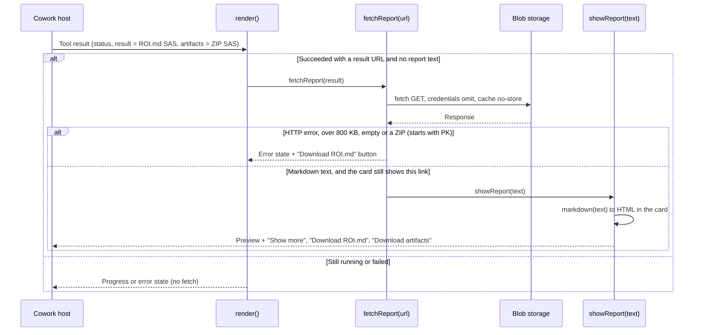

# Business case ROI.md preview in the browser

The business case report card reads `ROI.md` from its SAS URL in the browser, so the MCP server returns only links and
never downloads the report. The storage CORS rule must allow `GET` for the widget origin; see
[step 8 of the deployment guide](../inventory-deployment.md#8-optional-let-a-card-read-a-blob-in-the-browser-cors-get).

The card does this when it has storage connect domains: `AZMIGRATE_REPORT_WIDGET_DOMAINS`, or else
`AZMIGRATE_INVENTORY_WIDGET_DOMAINS`. Without them, the server downloads `ROI.md` and returns it in `report` as before.

```mermaid
sequenceDiagram
    actor U as User
    participant C as Cowork chat (model)
    participant M as MCP server
    participant DS as Discovery Service
    participant W as Report card (in Cowork)
    participant B as Blob storage

    U->>C: "Show my business case"
    C->>M: azure_catalyst_businesscase_status
    M->>DS: GET export?artifacts=external
    DS-->>M: { uri: ROI.md SAS }
    M->>DS: GET export?artifacts=internal
    DS-->>M: { uri: artifacts ZIP SAS }
    M-->>C: result = ROI.md SAS, artifacts = ZIP SAS (no report content)
    C-->>U: "Business case ready" + links (no figures; the model never sees the report)
    C->>W: Tool result (SAS URLs)
    W->>B: fetch(ROI.md SAS) [Origin: cowork-<hash>.widget-renderer.usercontent.microsoft]
    B-->>W: 200 ROI.md + Access-Control-Allow-Origin (needs GET in the CORS rule)
    W-->>U: Renders the ROI.md preview in the card
    U->>B: Clicks "Download artifacts" (navigation, no CORS)
    B-->>U: ZIP file
```

If the fetch fails (no `GET` in the rule, an expired SAS, a ZIP or a file over 800 KB), the card shows the
"Download ROI.md" button instead of the preview.

## Inside the card

All of this runs in the card's JavaScript (`BusinessCaseReportWidget`). The server only supplies the links.



The SAS links are short-lived. After they expire the fetch fails and the card falls back to the download button; asking
for the business case status again returns fresh links.