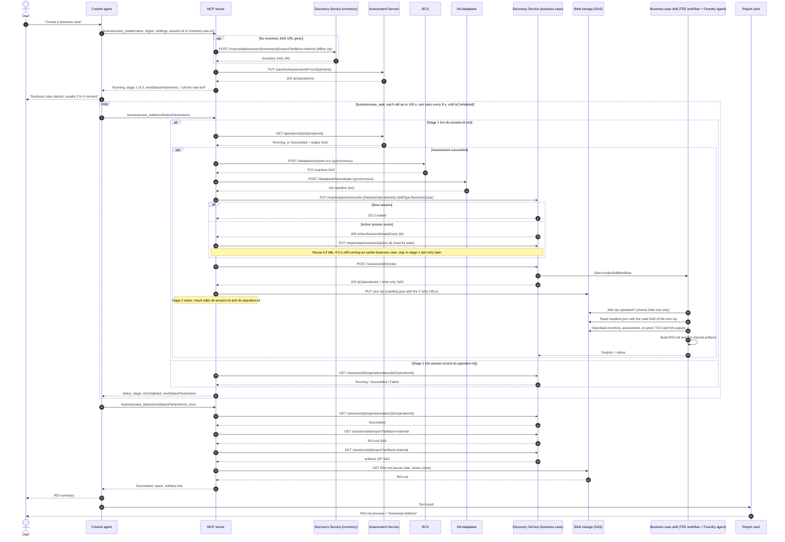

# Business case: create to ROI report (as implemented)

How a business case runs today: 2 stages (`Assessment`, then `HaSkill`), tracked by the agent with the wait tool and
finished with one status call that shows the report card. The MCP server keeps no run state: every call carries the
`nextStatusParameters` of the previous result. The only memory is a per-process start gate, so the agent's wait tool
and a card's status call never start the final stage twice. Background and decisions:
[business-case-plan.md](../business-case-plan.md).

Hosts: inventory Discovery Service on stamp04, business case Discovery Service on stamp03, Business Case Service (BCS)
and HA dataplane, and the Assessment Service (AS).

Notes:

- Transient errors (no response, 408, 429, 5xx) leave the business case `Running`; the next pass repeats the step.
  BCS and HA reuse earlier results for identical requests, so repeating them is safe.
- Any other error finishes the business case `Failed` with `failedStep` (for example `onPremTco`, `haEvaluate`,
  `invokeSession`, `uploadInput`).
- With `AZUREMIGRATE_HA_MOCK=true`, stage 1 ends by reading the HA manifest's summary and finishes `Succeeded` without
  the Discovery Service session.
- [01](01-business-case-roi-client-preview.md) shows the planned change: the card reads ROI.md in the browser instead of
  the server.
