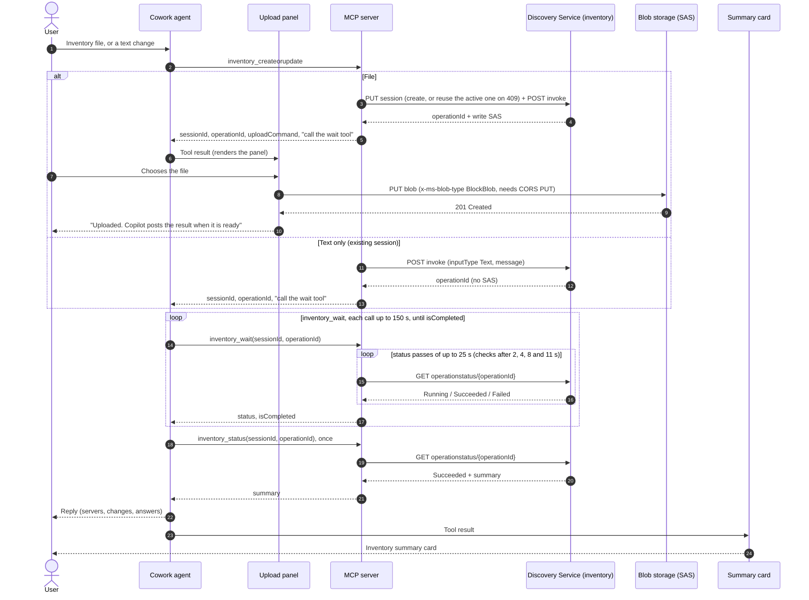

# Inventory: upload and tracking (as implemented)

How an inventory is created or refined today. The upload panel puts the file straight into blob storage from the browser
(the storage CORS rule must allow `PUT`; see [step 7 of the deployment guide](../inventory-deployment.md)). The agent
waits with the wait tool, then calls the status tool once so the summary card appears together with its reply. The
panel itself no longer polls. Background: [inventory-tool-guidance-plan.md](../inventory-tool-guidance-plan.md).

The agent writes nothing while it waits, so no progress text reaches the chat after the panel already shows the upload.
