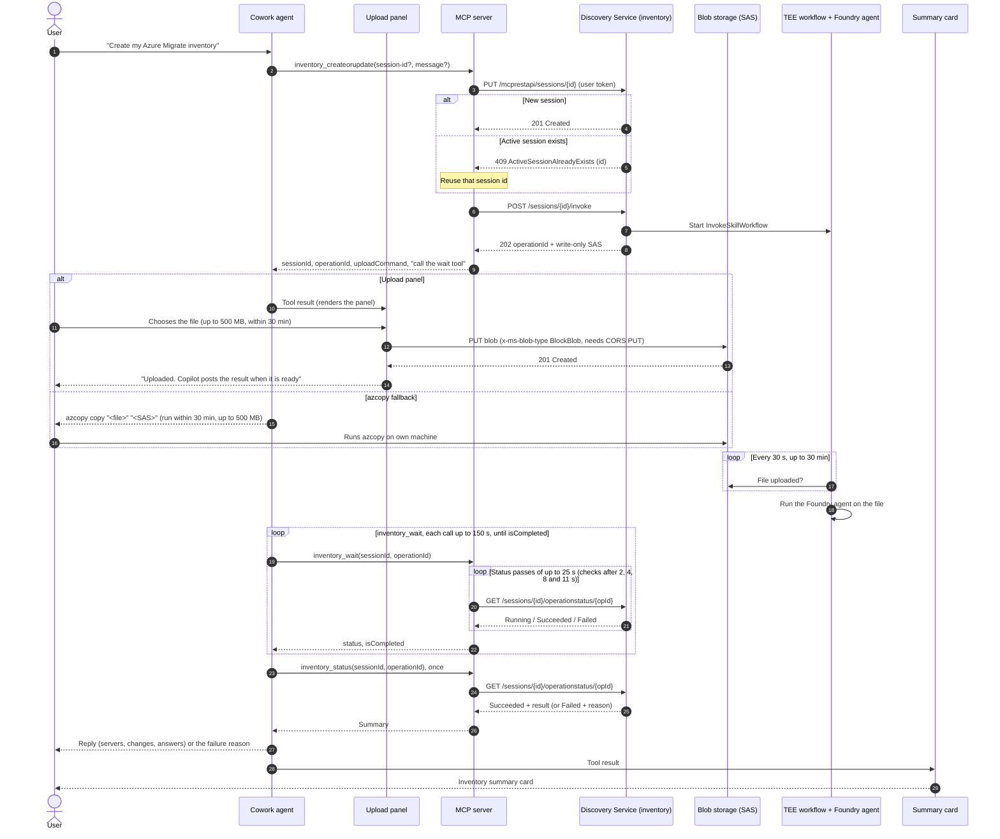

# Inventory: create from a file, upload and tracking (as implemented)

How a new inventory is created from a file. Replaces the earlier "create or update inventory" diagram, in which the
user ran azcopy and then asked for the status.

- **Upload panel** (when `AZMIGRATE_INVENTORY_WIDGET_DOMAINS` is set): the panel PUTs the file straight into blob
  storage from the browser. The storage CORS rule must allow `PUT`.
- **azcopy fallback** (no panel, or the browser upload is blocked): the user runs the returned `azcopy copy` command.

Either way, the agent then waits with the wait tool and calls the status tool once, so the summary card appears
together with its reply. Background: [inventory-tool-guidance-plan.md](../inventory-tool-guidance-plan.md).

The agent writes nothing while it waits, so no progress text reaches the chat after the panel already shows the upload.
The status is `Running` both while the Discovery Service waits for the file and while it processes it.
