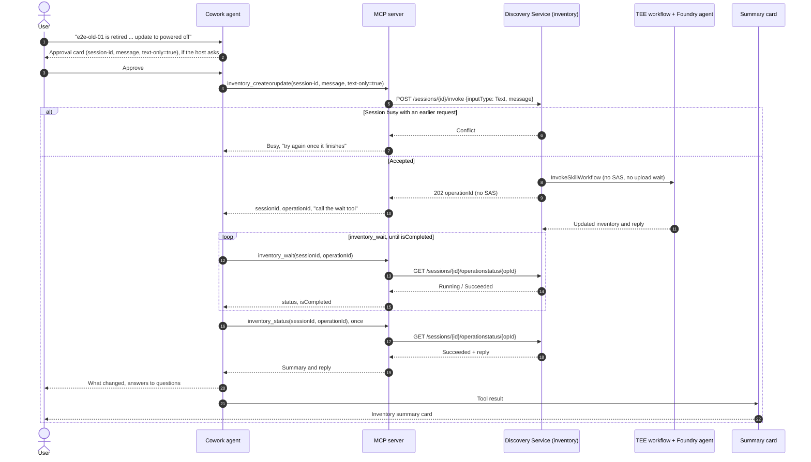

# Inventory: refine with a text change (as implemented)

How the user corrects or extends an existing inventory in plain words, for example "e2e-old-01 is retired, mark it
powered off". Replaces the earlier "refine inventory" diagram. Differences from that diagram:

- The MCP server no longer PUTs the session first: it invokes the existing session directly, so an unknown session
  fails with `404` instead of starting an empty inventory. A session with no completed import fails with `400`.
- The agent tracks the change itself with the wait tool. The user no longer has to ask for the status.

